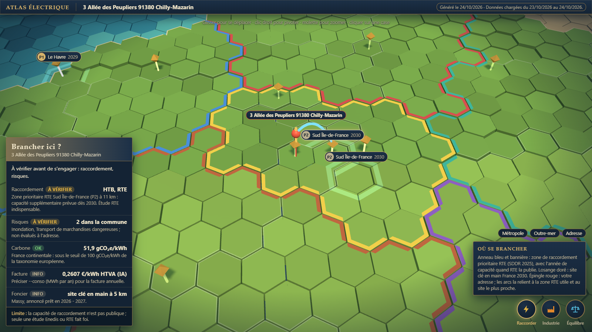
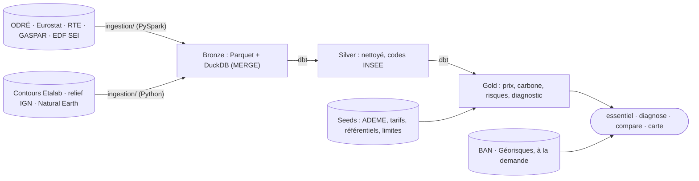

# Où brancher mon entreprise

**Une adresse française en entrée ; en sortie, la réponse à « puis-je brancher mon entreprise
ici ? »** : qui raccorde et à quelle échéance, les risques de la commune, le carbone du réseau, la
facture et le terrain prêt le plus proche. Données publiques uniquement, chaque chiffre avec sa
source et sa limite. Ligne de commande, en local. État et suite du projet : [PLAN.md](PLAN.md).



*La carte générée pour « 3 allée des Peupliers, 91380 Chilly-Mazarin », projet de 50 MW : le
raccordement relève de RTE et une zone prioritaire est à 11 km (arc bleu), un site clé en main à
5 km (arc doré). Diagnostic complet de Lyon : [en PDF](docs/exemples/implantation_lyon.pdf).*

## Trois faits à connaître

| | Pour le chef d'entreprise | Côté data engineering |
|---|---|---|
| **1. Le prix ne dépend pas de l'adresse** | La péréquation tarifaire rend le prix identique partout, Corse et outre-mer compris : environ 0,20 €/kWh HTVA pour 350 MWh par an. C'est la consommation qui fait la facture, pas le site. | Les tranches Eurostat `nrg_pc_205` (semestrielles, HTVA) sont jointes à la consommation annuelle ; des scénarios à 3 ans sont calibrés sur les erreurs passées, sans regard vers le futur. |
| **2. Le carbone change d'un facteur 10 à 18 entre systèmes électriques** | 51,9 gCO₂e/kWh sur tout le continent, 594 à 957 en Corse et outre-mer, non interconnectés. Le seuil européen (taxonomie) est 100 : il compte pour un financement vert. Sur une île, l'heure compte aussi : en Corse, 522 g vers 13 h contre 681 g vers 5 h. | Facteurs en cycle de vie de la Base Carbone ADEME, en seed daté ; jointure par système électrique dérivé du code INSEE, jamais par libellé. Profil horaire des îles tiré de la production par filière d'EDF SEI (263 000 heures), calé pour redonner le facteur ADEME annuel. |
| **3. La capacité de raccordement n'est pas publique** | Au-delà de 40 MW, c'est RTE et des délais de 2 à 7 ans. L'outil dit qui raccorde selon la puissance et signale la zone prioritaire RTE la plus proche ; seule une étude Enedis ou RTE fait foi. | Seuils de tension en seed, zones du SDDR 2025 géolocalisées, distance au plus proche dans DuckDB. Quand l'API Géorisques tombe, les risques viennent de l'export GASPAR chargé au `refresh`. |

## Prise en main (10 minutes)

Il faut Python 3.12 et Java 17 (pour PySpark). Tout tourne sur votre poste, sans compte.

**1. Installer**, une seule fois, dans un terminal PowerShell ouvert dans le dossier du projet :

```powershell
python -m venv .venv
.\.venv\Scripts\python.exe -m pip install -e . dbt-duckdb matplotlib reportlab pytest pytest-httpx ruff
Copy-Item .env.example .env
```

**2. Charger les données publiques** (une minute et demie environ) :

```powershell
.\.venv\Scripts\python.exe -m ingestion.cli refresh --months 180
```

Rien ne se met à jour tout seul : relancez `refresh` quand vous voulez des données fraîches. Chaque
réponse affiche la date des données utilisées.

**3. Poser la question** pour votre adresse, avec la puissance du projet en MW et la consommation
annuelle en MWh si vous les connaissez :

```powershell
.\.venv\Scripts\python.exe -m ingestion.cli essentiel --adresse "3 allée des peupliers 91380 Chilly-Mazarin" --puissance 50 --conso 350
```

```
3 Allée des Peupliers 91380 Chilly-Mazarin
Commune Chilly-Mazarin (91161) · Essonne (91) · Île-de-France (11)
Données chargées du 23/10/2026 au 24/10/2026.

Prix moyen : 0,1997 €/kWh HTVA, soit environ 69 900 € par an pour 350 MWh (tranche IB ; Eurostat, S2 2025 – S1 2026)
Électricité décarbonée : oui (France continentale), 51,9 gCO₂e/kWh en cycle de vie, sous le seuil de 100 gCO₂e/kWh
À savoir : Le prix ne dépend pas de l'adresse mais de la consommation (péréquation, Corse et outre-mer compris). […]
Brancher ici ? À vérifier avant de s'engager : raccordement, risques.
```

Avec l'export de votre **courbe de charge** (CSV téléchargé depuis votre espace client
Enedis), l'outil prend votre vraie consommation : volume annuel, pointe de puissance (donc qui
raccorde), part en heures creuses, coût au tarif HP/HC actuel et carbone de vos heures de
consommation. Un exemple est fourni pour essayer :

```powershell
.\.venv\Scripts\python.exe -m ingestion.cli essentiel --adresse "3 allée des peupliers 91380 Chilly-Mazarin" --courbe docs/exemples/courbe_bureau_septembre.csv
```

**4. Ouvrir la carte** `data/reports/carte.html` dans un navigateur : l'adresse y est épinglée et
la fiche « Brancher ici ? » détaille les cinq critères. Une adresse ambiguë (deux communes
possibles) est refusée avec les candidats : précisez le code postal.

## Commandes

Toutes s'écrivent `.\.venv\Scripts\python.exe -m ingestion.cli <commande>`.

| Commande | Effet |
|---|---|
| `essentiel --adresse "…" [--puissance MW] [--conso MWh] [--courbe CSV] [--ca €] [--va €] [--format json]` | Réponse courte : prix, carbone et verdict « brancher ici ? » ; `--courbe` lit l'export Enedis, `--ca` donne la part de la facture dans le chiffre d'affaires, `--va` l'électro-intensité fiscale (taux réduit d'accise dès 0,5 % de la valeur ajoutée) |
| `diagnose --adresse "…" [--puissance MW] [--conso MWh] [--courbe CSV] [--ca €] [--va €] [--format pdf\|md\|json]` | Diagnostic complet : industrie locale, réseau, raccordement, prix, carbone, risques |
| `compare --adresse "A" --adresse "B" …` | 2 à 6 adresses côte à côte, sans classement ; `texte`, `md`, `csv`, `json` |
| `carte [--adresse "…"] [--puissance MW] [--reconstruire]` | Carte 3D hors ligne (`data/reports/carte.html`) |
| `refresh [--months 180]` | Met à jour toutes les sources, puis `dbt build` |
| `report --month 2026-09` | Rapport mensuel carbone et créneaux Tempo (compte RTE requis) |

`essentiel` et `diagnose` épinglent aussi leur adresse sur la carte (`--sans-carte` pour s'en
passer). La carte n'est refaite que si le warehouse, les contours ou le gabarit sont plus récents
qu'elle ; sinon seule l'épingle et son verdict changent.

**La carte** s'ouvre sur la vue « Raccorder » : relief IGN en cases de 24 km, zones prioritaires RTE
(anneau et bannière avec l'année de capacité), sites clés en main France 2030 (losange doré), et
l'adresse reliée à la zone RTE utile et au site le plus proche. Deux vues secondaires : pression
industrielle par département et équilibre production/consommation régional (touches 1 à 3). Un
clic sur une case affiche la fiche du département.

**Identifiants** (Tempo seulement) : copiez `identifiants.exemple.txt` en `identifiants.local.txt`.
Ce fichier est ignoré par git et prime sur `.env`.

## Architecture



- **Ingestion idempotente en PySpark** : chaque lot est typé et normalisé par une session Spark
  locale (UTC, changements d'heure, clés complètes), puis écrit via Arrow ; BOM, codes IRIS
  tronqués et secret statistique sont traités en Python. Le bronze garde toutes les révisions en
  Parquet immuables (`data/bronze/<jeu>/ingest_date=…/part-<run_id>.parquet`), puis un `MERGE`
  sur clé dans DuckDB (`data/warehouse/eco2mix.duckdb`) : relancer ne duplique rien. Quota d'API
  suivi, bascule sur l'export CSV, nouvelles tentatives exponentielles.
- **Silver et gold en dbt-duckdb**, reconstruits à chaque run (quelques secondes). Jointures par
  code INSEE ; énergie = puissance × durée (jours de 23 ou 25 h) ; verdict carbone en cycle de vie.
- **Gold principal** : `fct_diagnostic_territoire` (une ligne par département),
  `fct_prix_entreprise_tranche`, `fct_carbone_territoire`, `fct_carbone_horaire_zni`,
  `fct_risques_commune`, `fct_mix`. Les
  seeds datés (tarifs, SDDR, sites clés en main, facteurs ADEME) sont à mettre à jour à chaque
  nouvelle source ; `limites_methodologiques` porte la limite de chaque indicateur.
- **Fiabilité** : géocodage BAN sur cinq candidats, adresse refusée si trop approximative ou
  ambiguë ; date des données affichée partout, avec alerte au-delà de 45 jours ; risques en repli
  local quand l'API Géorisques ne répond pas.
- `data/` n'est pas versionné et se recrée par `refresh`. DuckDB n'accepte qu'un writer : fermez
  toute session `duckdb` pendant un chargement.

## Tests

```powershell
.\.venv\Scripts\python.exe -m ruff check . ; .\.venv\Scripts\python.exe -m pytest
```

378 tests sans réseau, dont un `dbt build` complet sur une base synthétique qui reproduit les
pièges des sources, plus les tests de données dbt. La CI GitHub Actions les joue à chaque PR.

## Sources et licence

[ODRÉ](https://odre.opendatasoft.com) (éCO2mix, RTE) · [Eurostat](https://ec.europa.eu/eurostat) ·
[Base Carbone de l'ADEME](https://data.ademe.fr/datasets/base-carboner) ·
[Base Adresse Nationale](https://adresse.data.gouv.fr) · [Géorisques et GASPAR](https://www.georisques.gouv.fr) ·
[contours Etalab](https://etalab-datasets.geo.data.gouv.fr/contours-administratifs/) ·
[altimétrie IGN](https://geoservices.ign.fr/documentation/services/services-geoplateforme/altimetrie) ·
[Natural Earth](https://www.naturalearthdata.com) ·
[sites clés en main France 2030](https://www.data.gouv.fr/datasets/les-sites-cles-en-main-france-2030) ·
[EDF SEI](https://opendata.edf.fr/datasets/courbe-de-charge-de-la-production-delectricite-par-filiere) ·
SDDR 2025 de RTE · barèmes de la CRE.

Code sous [licence MIT](LICENSE) ; les données restent sous la licence de leurs producteurs.
[three.js](https://threejs.org) r128, embarqué dans `reporting/vendor/`, est sous licence MIT.
