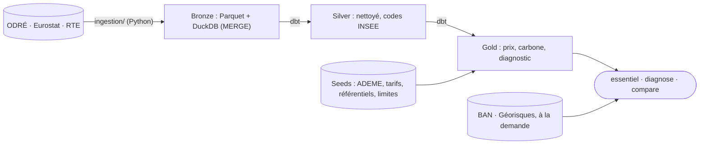

# Où brancher mon entreprise

**Une adresse française en entrée ; en sortie, le prix moyen de l'électricité et si elle est
décarbonée.** Données publiques uniquement, chaque chiffre avec sa source et sa limite. Ligne de
commande, en local.

```powershell
.\.venv\Scripts\python.exe -m ingestion.cli essentiel --adresse "1 cours Napoléon, 20000 Ajaccio" --conso 60000
```

```
1 Cours Napoléon 20000 Ajaccio
Commune Ajaccio (2A004) · Corse-du-Sud (2A) · Corse (94)

Prix moyen : 0,0916 €/kWh HTVA, soit environ 5 500 000 € par an pour 60 000 MWh (tranche IE ; Eurostat, S2 2025 – S1 2026)
Électricité décarbonée : non (Corse), 594 gCO₂e/kWh en cycle de vie, au-dessus du seuil de 100 gCO₂e/kWh
À savoir : Le prix ne dépend pas de l'adresse mais de la consommation (péréquation, Corse et outre-mer compris). […]
```

Exemples réels : [recette sur 11 adresses](docs/exemples/recette_mvp.md) ·
[diagnostic complet de Lyon](docs/exemples/implantation_lyon.md) ([PDF](docs/exemples/implantation_lyon.pdf)) ·
[comparaison de 3 villes](docs/exemples/comparaison_lyon_lille_poitiers.md).

## Trois points forts pour un data engineer

1. **Une ingestion Python idempotente, éprouvée sur les pièges réels des sources.** Chaque lot
   est typé, normalisé et filtré avec pyarrow ; bronze en Parquet immuables (toutes les révisions
   gardées) puis `MERGE` sur clé dans DuckDB, jamais d'`INSERT` : relancer ne duplique rien. Changements d'heure normalisés en UTC, révisions de RTE rattrapées,
   quota d'API suivi, bascule automatique sur l'export CSV, nouvelles tentatives exponentielles ;
   BOM, codes IRIS tronqués et secret statistique traités et testés.
2. **Un médaillon dbt testé de bout en bout, sans réseau.** 318 tests pytest, dont un `dbt build`
   complet sur une base synthétique qui reproduit ces pièges ; tests de données dbt (unicité,
   bornes, intégrité référentielle) à chaque build ; CI GitHub Actions à chaque PR. Les scénarios
   de prix sont contrôlés sur le passé, sans regard vers le futur.
3. **Des choix proportionnés et des chiffres honnêtes.** Python uniquement : pyarrow pour
   l'ingestion, dbt et DuckDB pour le stockage et la lecture (`essentiel` répond en 1,5 s),
   reconstruction complète plutôt qu'incrémental, interface `WarehouseLoader` prête pour BigQuery. Chaque indicateur porte sa source, sa maille et sa
   limite (`limites_methodologiques.csv`), conformément aux règles sur les allégations
   environnementales (directive EmpCo).

## Installation et mise à jour

Python 3.12 suffit : aucune autre dépendance système. Tout tourne en local, sans compte (sauf le
calendrier Tempo, optionnel).

```powershell
python -m venv .venv
.\.venv\Scripts\python.exe -m pip install -e . dbt-duckdb matplotlib reportlab pytest pytest-httpx ruff
Copy-Item .env.example .env
.\.venv\Scripts\python.exe -m ingestion.cli refresh --months 180
```

`refresh` relit toutes les sources (une dizaine d'appels d'API) puis lance `dbt build`, en une
minute environ. Rien ne tourne tout seul : relancez `refresh` (sans `--months`) pour mettre les
données à jour. Avec [uv](https://docs.astral.sh/uv/), `uv sync --group dev --group dbt --group report`
remplace les deux premières lignes, et `uv run python` remplace `.\.venv\Scripts\python.exe`.

## Commandes

Toutes s'écrivent `.\.venv\Scripts\python.exe -m ingestion.cli <commande>`.

| Commande | Effet |
|---|---|
| `essentiel --adresse "…" [--conso N] [--format json]` | Prix moyen et verdict carbone ; sans `--conso`, tranche des petites entreprises (moins de 20 MWh/an) |
| `diagnose --adresse "…" [--puissance MW] [--conso N] [--format pdf\|md\|json]` | Diagnostic complet : industrie locale, réseau, raccordement, prix, carbone, risques |
| `compare --adresse "A" --adresse "B" …` | 2 à 6 adresses côte à côte, sans classement ; `texte`, `md`, `csv`, `json` |
| `refresh [--months 180]` | Met à jour toutes les sources, puis `dbt build` |
| `report --month 2026-09` | Rapport mensuel carbone et créneaux Tempo (compte RTE requis pour Tempo) |

## Ce que l'adresse change, et ce qu'elle ne change pas

- **Le prix ne dépend pas de l'adresse** : la péréquation le rend identique partout. Il dépend de
  la consommation (tranches Eurostat `nrg_pc_205`).
- **Le carbone ne change qu'entre systèmes électriques** : 51,9 gCO₂e/kWh sur tout le continent
  (ADEME 2024), 594 à 957 en Corse et outre-mer, non interconnectés. Verdict au seuil de
  100 gCO₂e/kWh de la taxonomie européenne ; c'est la moyenne du réseau, pas celle d'un contrat.
- **La capacité de raccordement n'est pas en open data** : seule une étude RTE ou Enedis fait foi.

Le raisonnement complet est dans le [cadrage](docs/cadrage-besoins-entreprises.md).

## Architecture



Détail : [modèles dbt](dbt/README.md) · [stockage](data/README.md).

## Tests

```powershell
.\.venv\Scripts\python.exe -m ruff check . ; .\.venv\Scripts\python.exe -m pytest
```

## Documentation

| Document | Contenu |
|---|---|
| [Feuille de route](docs/feuille-de-route.md) | État du MVP, suite, décisions datées |
| [Extension internationale](docs/extension-internationale.md) | Pistes pour d'autres pays |
| [Cadrage](docs/cadrage-besoins-entreprises.md) · [Revue des besoins](docs/revue-besoins-entreprises.md) · [Veille](docs/veille-projets-similaires.md) | Études datées des 9 et 15 oct. 2026 |

## Sources

[ODRÉ](https://odre.opendatasoft.com) (éCO2mix, RTE) · [Eurostat](https://ec.europa.eu/eurostat) ·
[Base Carbone de l'ADEME](https://data.ademe.fr/datasets/base-carboner) ·
[Base Adresse Nationale](https://adresse.data.gouv.fr) · [Géorisques](https://www.georisques.gouv.fr) ·
[sites clés en main France 2030](https://www.data.gouv.fr/datasets/les-sites-cles-en-main-france-2030) ·
SDDR 2025 de RTE · barèmes de la CRE. Licence Ouverte / Etalab.

## Licence

Code sous [licence MIT](LICENSE). Les données restent sous la licence de leurs producteurs.
