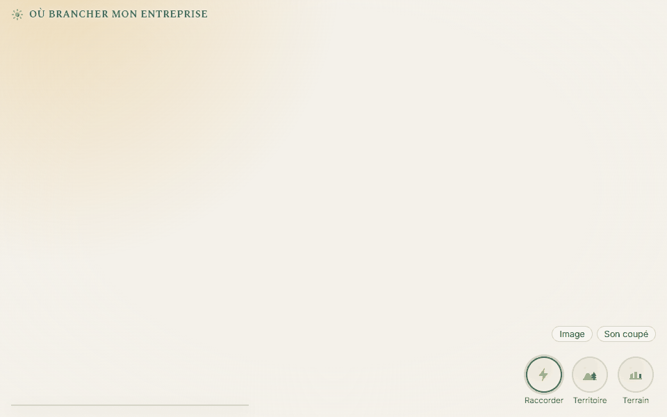
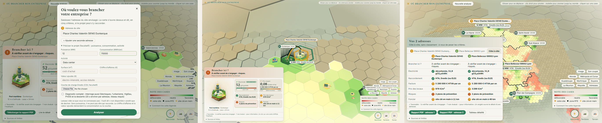
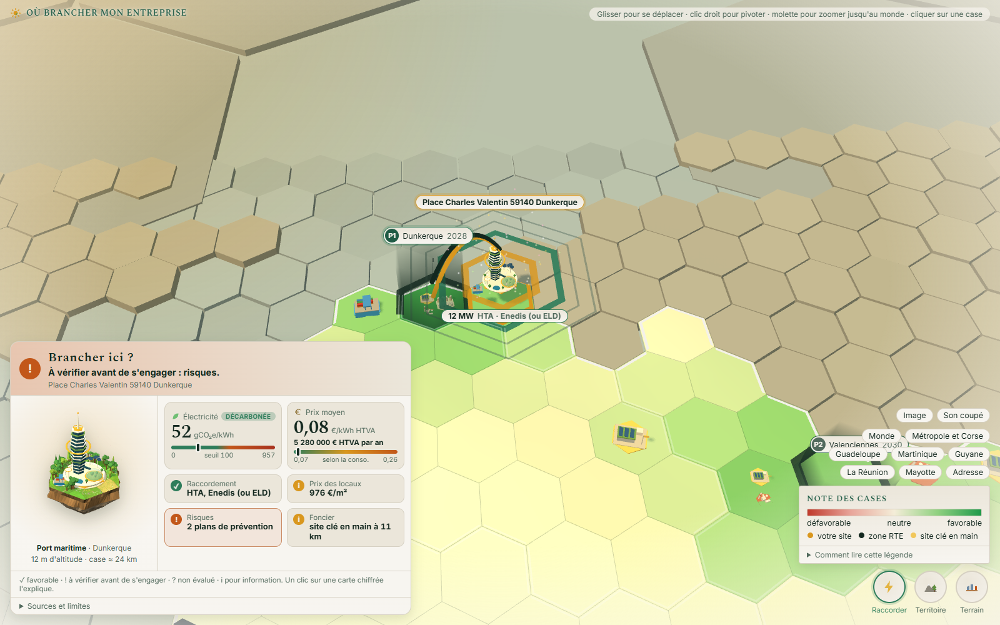
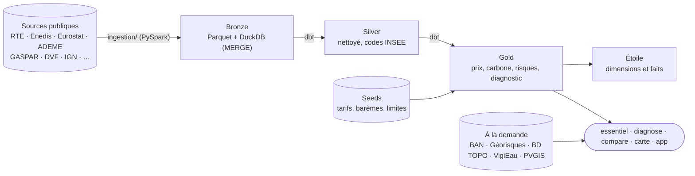

# Où brancher mon entreprise

> **Un projet de 1 à 50 MW peut-il se brancher à cette adresse ? Qui le raccorde, dans quel délai,
> à quel coût ? Réponse en une commande, à partir des seules données publiques.**



*Exemple de référence : un data center de 12 MW et 70 000 MWh par an à Dunkerque (59).*

## Pourquoi

Plus de 200 projets industriels, près de 33 GW, attendent un raccordement au réseau haute tension
([RTE, juillet 2026](https://www.rte-france.com/actualites/2026-07-03-reussir-electrification-france)).
Pour un projet de 1 à 50 MW, l'électricité est le critère d'implantation : le prix est le même
partout (péréquation), mais **la puissance disponible, son délai et le gestionnaire qui raccorde**
dépendent du site. L'outil rassemble ce que l'open data permet de dire, avec la source et la limite
de chaque chiffre, et écrit « non disponible » plutôt que de deviner.

Pour des bureaux, rien de décisif : le prix de l'électricité ne départage pas les villes.

## Ce que l'outil répond

Une adresse (et, si on les connaît, la puissance et la consommation) donne un verdict « Brancher
ici ? » en cinq critères :

| Critère | Ce qu'on regarde |
|---|---|
| Raccordement | Domaine de tension (HTA, HTB), gestionnaire (Enedis, RTE, EDF SEI en Corse et outre-mer), zone prioritaire RTE la plus proche |
| Risques | Plans de prévention de la commune, sismicité, voisinage (Seveso, installations classées, sols pollués, argiles) |
| Carbone | Facteur du système électrique face au seuil de 100 gCO₂e/kWh, heure par heure sur les îles |
| Facture | Prix moyen par tranche de consommation, part acheminement (TURPE 7), accise réduite possible |
| Foncier | Zonage d'urbanisme, friches, zones d'activité, sites clés en main, prix des locaux, desserte |

`diagnose` ajoute l'eau, le solaire, la main-d'œuvre et une vue aérienne datée du site.

**Ce que l'outil ne dit pas**, faute de source publique : la capacité réellement disponible au poste
(seule l'étude d'Enedis ou de RTE fait foi), le droit effectif à un tarif d'accise réduit, le loyer des locaux.



## Démarrer

Python 3.12 et Java 17 (pour PySpark). Tout tourne sur votre poste, sans compte ni hébergement.

```powershell
python -m venv .venv
.\.venv\Scripts\python.exe -m pip install -e . dbt-duckdb matplotlib reportlab pytest pytest-cov pytest-httpx pypdf ruff
Copy-Item .env.example .env
```

**Essayer sans rien charger** (base synthétique, chiffres fictifs, une minute la première fois) :

```powershell
.\.venv\Scripts\python.exe -m ingestion.cli demo
```

**Vraies données** (une vingtaine de minutes ; à relancer pour les rafraîchir) :

```powershell
.\.venv\Scripts\python.exe -m ingestion.cli refresh --months 180
```

**Application** : le navigateur s'ouvre sur `http://127.0.0.1:8770/` ; on saisit une ou deux adresses,
on précise le projet si on veut, puis « Analyser ».

```powershell
.\.venv\Scripts\python.exe -m ingestion.cli app
```

**Ligne de commande** :

```powershell
.\.venv\Scripts\python.exe -m ingestion.cli essentiel --adresse "Place Charles Valentin 59140 Dunkerque" --puissance 12 --conso 70000 --activite data-center
```

```
Prix moyen : 0,0754 €/kWh HTVA, soit environ 5 280 000 € par an pour 70 000 MWh (tranche IF ; Eurostat)
Acheminement : environ 1 370 000 € HTVA par an, déjà compris dans le prix moyen (TURPE 7 HTA)
Électricité décarbonée : oui (France continentale), 51,9 gCO₂e/kWh, sous le seuil de 100
Locaux d'activité : 976 €/m² à la vente à Dunkerque (médiane de 321 ventes ; DVF)
Brancher ici ? À vérifier avant de s'engager : risques.
```

## Commandes

Toutes s'écrivent `.\.venv\Scripts\python.exe -m ingestion.cli <commande>` ; `--help` donne les options.

| Commande | Effet |
|---|---|
| `essentiel` | Réponse courte : prix, carbone, locaux d'activité, verdict |
| `diagnose` | Diagnostic complet en PDF, Markdown ou JSON |
| `compare` | 2 à 6 adresses côte à côte, sans classement (texte, Markdown, CSV, JSON) |
| `app` | Application locale dans le navigateur |
| `carte` | Carte 3D autonome (`data/reports/carte.html`) |
| `demo` | `essentiel` et la carte sur une base synthétique |
| `refresh` | Met à jour toutes les sources, puis `dbt build` |
| `europe` | Prix et carbone du pays, dans l'UE |
| `tempo`, `ecowatt`, `report` | Rapport mensuel carbone et créneaux Tempo (comptes RTE requis) |

Options de projet communes à `essentiel`, `diagnose` et `compare` : `--puissance` (MW), `--conso`
(MWh par an), `--activite data-center|irve|industrie|logistique`, `--surface` (m²), `--ca` et `--va`
(€, pour la part de la facture et l'accise réduite), `--courbe` (export CSV de la courbe de charge
Enedis, [exemple](docs/exemples/courbe_industrie_septembre.csv)).

Les identifiants RTE (`tempo`, `ecowatt` seulement) se mettent dans `identifiants.local.txt`
(modèle : `identifiants.exemple.txt`), ignoré par git.

## La carte

Une carte 3D hors ligne, générée en une page HTML (three.js embarqué). Trois vues : **Raccorder**
(cases notées du rouge au vert, zones RTE, sites clés en main, centrales), **Terrain** (friches, zones
d'activité, Seveso, fret autour de l'adresse) et **Territoire** (paysage réel, carbone, prix moyen).
Un curseur horaire suit le carbone des îles. Touche 0 : le monde en tuiles.



Diagnostic complet de l'exemple : [PDF](docs/exemples/implantation_dunkerque.pdf).

## Architecture



- **Bronze** : chaque lot est typé par PySpark, écrit en Parquet immuable
  (`data/bronze/<jeu>/ingest_date=…/`), puis fusionné par `MERGE` dans DuckDB : relancer ne duplique rien.
- **Silver et gold** : dbt-duckdb (`dbt/`), reconstruits à chaque `refresh`. Les barèmes datés
  (TURPE, accise, facteurs ADEME) sont des seeds ; `limites_methodologiques` porte la limite de chaque indicateur.
- **Étoile** : `dbt/models/etoile/`, pour l'analyse en SQL ou en outil de BI.
- **À la demande** : ce qui dépend du point et change sans prévenir (urbanisme, eau, solaire, itinéraires)
  est appelé au moment de la question, jamais stocké ; une source en panne est signalée dans sa section
  sans bloquer le reste.

### Où lire le code

| Dossier | Contenu |
|---|---|
| `ingestion/` | CLI (`cli.py`), un `extract_*.py` par source, chargement (`pipeline.py`, `warehouse.py`), calculs (`turpe.py`, `courbe.py`), clients à la demande |
| `ingestion/diagnostic/` | `requetes` et `lecture` (warehouse), `modeles`, `lignes_*` (une ligne de sortie par indicateur), `verdict` (cinq critères), `essentiel`, `sections`, `completer` (sources à la demande) |
| `reporting/` | Carte 3D (`carte.py`, `carte.html`), application (`app.py`), PDF, Markdown, charte graphique |
| `dbt/` | Modèles bronze, silver, gold, étoile ; seeds et leurs tests |
| `ingestion/tests/` | Tests sans réseau et base synthétique (`medallion.py`) |

Ajouter une source : producteur officiel, licence ouverte, extraction vers un Parquet bronze, `MERGE`,
modèles silver et gold, limite dans le seed `limites_methodologiques`.

## Tests

```powershell
.\.venv\Scripts\python.exe .claude/scripts/verifier.py
```

`ruff`, puis `pytest` (964 tests sans réseau, `dbt build` sur base synthétique, sorties de référence
figées, sept parcours de l'application dans Chromium via `pytest-playwright`, couverture plancher de
92,5 %), puis un essai réel sur cinq cas (warehouse et réseau requis). `--rapide` saute `pytest`,
`--sans-essai` saute l'essai réel. Après un changement voulu de libellé :
`pytest ingestion/tests/test_references.py --maj-references`. La CI GitHub Actions joue `ruff` et
`pytest` sous Ubuntu et Windows.

## Sources et licence

Toutes les sources sont officielles et en licence ouverte : [ODRÉ](https://odre.opendatasoft.com)
(RTE), [Eurostat](https://ec.europa.eu/eurostat), [ADEME](https://data.ademe.fr),
[BAN](https://adresse.data.gouv.fr), [Géorisques](https://www.georisques.gouv.fr),
[Enedis](https://opendata.enedis.fr), [EDF SEI](https://opendata.edf.fr),
[Ember](https://ember-energy.org), [DVF](https://www.data.gouv.fr/en/datasets/dvf),
[Cartofriches](https://cartofriches.cerema.fr), [France Chaleur Urbaine](https://www.data.gouv.fr/datasets/64f05d3568e4d575eb454ffe),
[Insee](https://www.insee.fr), [France Travail](https://www.data.gouv.fr/datasets/561fa564c751df4f2acdbb48),
[IGN](https://geoservices.ign.fr) (BD TOPO, BD ORTHO, altimétrie, API Carto),
[VigiEau](https://vigieau.gouv.fr), [Sandre](https://www.sandre.eaufrance.fr),
[PVGIS](https://joint-research-centre.ec.europa.eu/photovoltaic-geographical-information-system-pvgis_en),
[SDES](https://www.data.gouv.fr/datasets/maritime-transport-de-marchandises),
[DGAC](https://www.data.gouv.fr/datasets/64808a5811da153f1439914c),
[SNCF Réseau](https://www.data.gouv.fr/datasets/chantiers-de-transport-combines),
[Natural Earth](https://www.naturalearthdata.com), [Nominatim](https://nominatim.openstreetmap.org) (© OpenStreetMap),
barèmes de la CRE (TURPE 7), textes de [Légifrance](https://www.legifrance.gouv.fr) (accise, obligations de solarisation).
La licence exacte de chaque jeu est celle de son producteur.

Code sous [licence MIT](LICENSE). [three.js](https://threejs.org) r186 (`reporting/vendor/`, MIT) ;
polices [Spectral](https://github.com/productiontype/Spectral) et [Inter](https://github.com/rsms/inter)
(`reporting/polices/`, SIL OFL 1.1).

État du projet et suite : [PLAN.md](PLAN.md).
