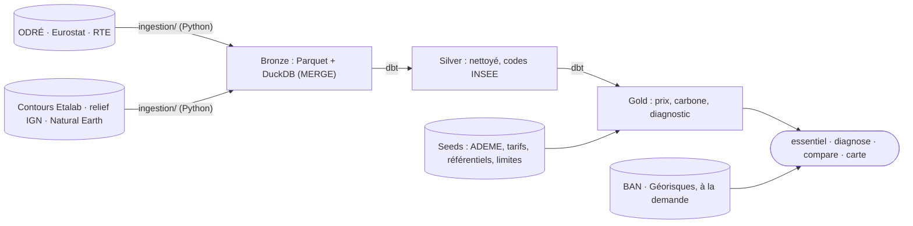

# Où brancher mon entreprise

**Une adresse française en entrée ; en sortie, le prix moyen de l'électricité et si elle est
décarbonée.** Données publiques uniquement, chaque chiffre avec sa source et sa limite. Ligne de
commande, en local. État et suite du projet : [PLAN.md](PLAN.md).

```powershell
.\.venv\Scripts\python.exe -m ingestion.cli essentiel --adresse "20 rue de la République, 69002 Lyon" --conso 350 --ca 5000000
```

```
20 Rue de la République 69002 Lyon
Commune Lyon (69123) · Rhône (69) · Auvergne-Rhône-Alpes (84)

Prix moyen : 0,1997 €/kWh HTVA, soit environ 69 900 € par an pour 350 MWh (tranche IB ; Eurostat, S2 2025 – S1 2026)
Électricité décarbonée : oui (France continentale), 51,9 gCO₂e/kWh en cycle de vie, sous le seuil de 100 gCO₂e/kWh
Part du chiffre d'affaires : 1,4 % (69 900 € sur 5 000 000 €), de 1,3 % à 2,0 % avec les scénarios à 3 ans
À savoir : Le prix ne dépend pas de l'adresse mais de la consommation (péréquation, Corse et outre-mer compris). […]
```

Exemple de diagnostic complet : [Lyon, en PDF](docs/exemples/implantation_lyon.pdf).

## Ce que l'adresse change, et ce qu'elle ne change pas

- **Le prix ne dépend pas de l'adresse** : la péréquation le rend identique partout, Corse et
  outre-mer compris. Il dépend de la consommation (tranches Eurostat `nrg_pc_205`).
- **Le carbone ne change qu'entre systèmes électriques** : 51,9 gCO₂e/kWh sur tout le continent
  (ADEME 2024), 594 à 957 en Corse et outre-mer, non interconnectés. Le verdict se fait au seuil
  de 100 gCO₂e/kWh de la taxonomie européenne : c'est la moyenne du réseau, pas celle d'un contrat.
- **La capacité de raccordement n'est pas en open data** : seule une étude RTE ou Enedis fait foi.
  L'outil signale la zone prioritaire RTE et le site clé en main les plus proches.

## Installation et mise à jour

Python 3.12. Tout tourne en local, sans compte (sauf le calendrier Tempo, optionnel).

```powershell
python -m venv .venv
.\.venv\Scripts\python.exe -m pip install -e . dbt-duckdb matplotlib reportlab pytest pytest-httpx ruff
Copy-Item .env.example .env
.\.venv\Scripts\python.exe -m ingestion.cli refresh --months 180
```

`refresh` relit toutes les sources puis lance `dbt build`, en une minute environ. Rien ne tourne
tout seul : relancez `refresh` pour mettre les données à jour. Avec [uv](https://docs.astral.sh/uv/),
`uv sync --group dev --group dbt --group report` remplace les deux premières lignes.

**Identifiants** (Tempo seulement) : copiez `identifiants.exemple.txt` en
`identifiants.local.txt`. Ce fichier est ignoré par git et prime sur `.env`.

## Commandes

Toutes s'écrivent `.\.venv\Scripts\python.exe -m ingestion.cli <commande>`.

| Commande | Effet |
|---|---|
| `essentiel --adresse "…" [--conso MWh] [--ca €] [--format json]` | Prix moyen et verdict carbone ; sans `--conso`, tranche des petites entreprises (moins de 20 MWh/an) ; `--ca` donne la part de la facture dans le chiffre d'affaires |
| `diagnose --adresse "…" [--puissance MW] [--conso MWh] [--ca €] [--format pdf\|md\|json]` | Diagnostic complet : industrie locale, réseau, raccordement, prix, carbone, risques (Géorisques) |
| `compare --adresse "A" --adresse "B" …` | 2 à 6 adresses côte à côte, sans classement ; `texte`, `md`, `csv`, `json` |
| `carte [--adresse "…"]` | Carte 3D hors ligne (`data/reports/carte.html`) : relief IGN en cases de 24 km, quatre lentilles (terrain, industrie, réseau RTE, équilibre régional), outre-mer en encarts |
| `refresh [--months 180]` | Met à jour toutes les sources, puis `dbt build` |
| `report --month 2026-09` | Rapport mensuel carbone et créneaux Tempo |

## Architecture



- **Ingestion idempotente** : chaque lot est typé et normalisé en Python (UTC, BOM, codes IRIS
  tronqués, secret statistique). Le bronze garde toutes les révisions en Parquet immuables
  (`data/bronze/<jeu>/ingest_date=…/part-<run_id>.parquet`), puis un `MERGE` sur clé dans DuckDB
  (`data/warehouse/eco2mix.duckdb`) : relancer ne duplique rien. Quota d'API suivi, bascule sur
  l'export CSV, nouvelles tentatives exponentielles.
- **Silver et gold en dbt-duckdb**, reconstruits à chaque run (quelques secondes). Jointures par
  code INSEE, jamais par libellé ; énergie = puissance × durée (jours de 23 ou 25 h) ; scénarios
  de prix à 3 ans sans regard vers le futur, calibrés sur les erreurs passées ; verdict carbone
  en cycle de vie, le `taux_co2` de RTE (émissions directes) en complément.
- **Gold principal** : `fct_diagnostic_territoire` (une ligne par département),
  `fct_prix_entreprise_tranche`, `fct_carbone_territoire`, `fct_mix`. Les seeds datés (tarifs,
  SDDR, sites clés en main, facteurs ADEME) sont à mettre à jour à chaque nouvelle source ;
  `limites_methodologiques` porte la limite de chaque indicateur.
- `data/` n'est pas versionné et se recrée par `refresh`. DuckDB n'accepte qu'un writer : fermez
  toute session `duckdb` pendant un chargement.

## Tests

```powershell
.\.venv\Scripts\python.exe -m ruff check . ; .\.venv\Scripts\python.exe -m pytest
```

338 tests sans réseau, dont un `dbt build` complet sur une base synthétique qui reproduit les
pièges des sources, plus les tests de données dbt. La CI GitHub Actions les joue à chaque PR.

## Sources et licence

[ODRÉ](https://odre.opendatasoft.com) (éCO2mix, RTE) · [Eurostat](https://ec.europa.eu/eurostat) ·
[Base Carbone de l'ADEME](https://data.ademe.fr/datasets/base-carboner) ·
[Base Adresse Nationale](https://adresse.data.gouv.fr) · [Géorisques](https://www.georisques.gouv.fr) ·
[contours Etalab](https://etalab-datasets.geo.data.gouv.fr/contours-administratifs/) ·
[altimétrie IGN](https://geoservices.ign.fr/documentation/services/services-geoplateforme/altimetrie) ·
[Natural Earth](https://www.naturalearthdata.com) ·
[sites clés en main France 2030](https://www.data.gouv.fr/datasets/les-sites-cles-en-main-france-2030) ·
SDDR 2025 de RTE · barèmes de la CRE.

Code sous [licence MIT](LICENSE) ; les données restent sous la licence de leurs producteurs.
[three.js](https://threejs.org) r128, embarqué dans `reporting/vendor/`, est sous licence MIT.
