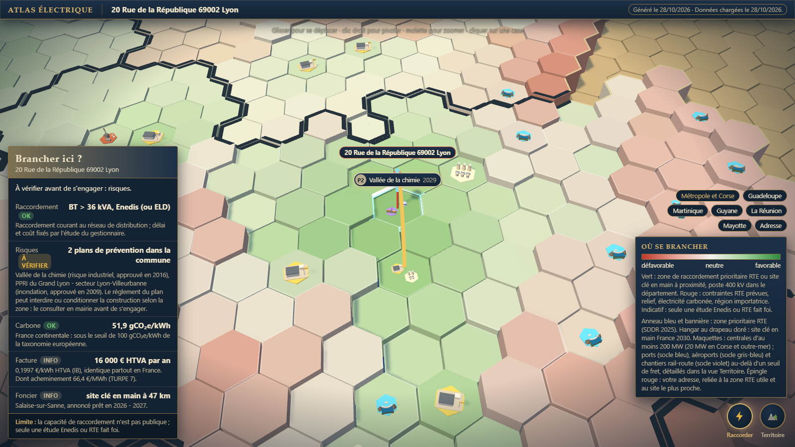
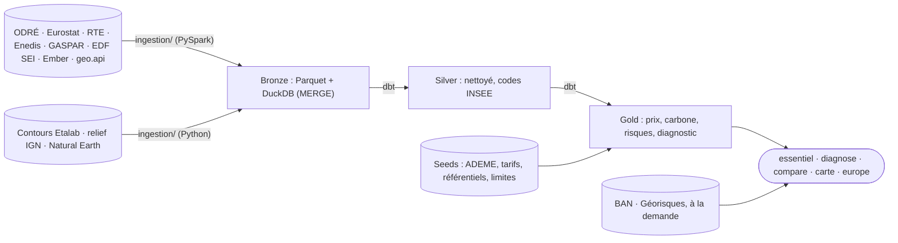

# Où brancher mon entreprise

**Une adresse française en entrée ; en sortie, la réponse à « puis-je brancher mon entreprise
ici ? »** : qui raccorde et à quelle échéance, les risques de la commune, le carbone du réseau, la
facture et le terrain prêt le plus proche. Données publiques uniquement, chaque chiffre avec sa
source et sa limite. Ligne de commande, en local. État et suite du projet : [PLAN.md](PLAN.md).



*La carte générée pour « 20 rue de la République, 69002 Lyon », des bureaux de 100 kVA et 80 MWh par
an : raccordement courant au réseau de distribution, carbone sous le seuil de 100 g, facture
d'environ 16 000 € HTVA par an ; seuls les deux plans de prévention de la commune (risque
industriel, inondation) restent à vérifier. Diagnostic complet de Lyon : [en PDF](docs/exemples/implantation_lyon.pdf).*

## Trois faits à connaître

| | Pour le chef d'entreprise | Côté data engineering |
|---|---|---|
| **1. Le prix ne dépend pas de l'adresse** | La péréquation tarifaire rend le prix identique partout, Corse et outre-mer compris : environ 0,20 €/kWh HTVA pour 350 MWh par an. C'est la consommation qui fait la facture, pas le site. | Les tranches Eurostat `nrg_pc_205` (semestrielles, HTVA) sont jointes à la consommation annuelle ; des scénarios à 3 ans sont calibrés sur les erreurs passées, sans regard vers le futur. |
| **2. Le carbone change d'un facteur 10 à 18 entre systèmes électriques** | 51,9 gCO₂e/kWh sur tout le continent, 594 à 957 en Corse et outre-mer, non interconnectés. Le seuil européen (taxonomie) est 100 : il compte pour un financement vert. Sur une île, l'heure compte aussi : en Corse, 522 g vers 13 h contre 681 g vers 5 h. | Facteurs en cycle de vie de la Base Carbone ADEME, en seed daté ; jointure par système électrique dérivé du code INSEE, jamais par libellé. Profil horaire des îles tiré de la production par filière d'EDF SEI (263 000 heures), calé pour redonner le facteur ADEME annuel. |
| **3. La capacité de raccordement n'est pas publique** | Au-delà de 40 MW, c'est RTE et des délais de 2 à 7 ans. L'outil dit qui raccorde selon la puissance et signale la zone prioritaire RTE la plus proche ; seule une étude Enedis ou RTE fait foi. | Seuils de tension en seed, zones du SDDR 2025 géolocalisées, distance au plus proche dans DuckDB. Quand l'API Géorisques tombe, les risques viennent de l'export GASPAR chargé au `refresh`, qui fournit aussi les plans de prévention de chaque commune. |

## Prise en main (10 minutes)

Il faut Python 3.12 et Java 17 (pour PySpark). Tout tourne sur votre poste, sans compte.

**1. Installer**, une seule fois, dans un terminal PowerShell ouvert dans le dossier du projet :

```powershell
python -m venv .venv
.\.venv\Scripts\python.exe -m pip install -e . dbt-duckdb matplotlib reportlab pytest pytest-httpx ruff
Copy-Item .env.example .env
```

**2. Charger les données publiques** (deux minutes environ) :

```powershell
.\.venv\Scripts\python.exe -m ingestion.cli refresh --months 180
```

Rien ne se met à jour tout seul : relancez `refresh` quand vous voulez des données fraîches. Chaque
réponse affiche la date des données utilisées. Une question posée avant ce premier chargement, ou
après un `refresh` interrompu, rappelle la commande à lancer.

**3. Poser la question** pour votre adresse, avec la puissance du projet en MW et la consommation
annuelle en MWh si vous les connaissez :

```powershell
.\.venv\Scripts\python.exe -m ingestion.cli essentiel --adresse "3 allée des peupliers 91380 Chilly-Mazarin" --puissance 50 --conso 350
```

```
3 Allée des Peupliers 91380 Chilly-Mazarin
Commune Chilly-Mazarin (91161) · Essonne (91) · Île-de-France (11)
Données chargées du 23/10/2026 au 24/10/2026.

Prix moyen : 0,1997 €/kWh HTVA, soit environ 69 900 € par an pour 350 MWh (tranche IB ; Eurostat, S2 2025 – S1 2026)
Électricité décarbonée : oui (France continentale), 51,9 gCO₂e/kWh en cycle de vie, sous le seuil de 100 gCO₂e/kWh
À savoir : Le prix ne dépend pas de l'adresse mais de la consommation (péréquation, Corse et outre-mer compris). […]
Brancher ici ? À vérifier avant de s'engager : raccordement, risques.
```

Avec l'export de votre **courbe de charge** (CSV téléchargé depuis votre espace client
Enedis), l'outil prend votre vraie consommation : volume annuel, pointe de puissance (donc qui
raccorde), part en heures creuses, coût au tarif HP/HC actuel et carbone de vos heures de
consommation. Un exemple est fourni pour essayer :

```powershell
.\.venv\Scripts\python.exe -m ingestion.cli essentiel --adresse "3 allée des peupliers 91380 Chilly-Mazarin" --courbe docs/exemples/courbe_bureau_septembre.csv
```

**4. Ouvrir la carte** `data/reports/carte.html` dans un navigateur : l'adresse y est épinglée et
la fiche « Brancher ici ? » détaille les cinq critères. Une adresse ambiguë (deux communes
possibles) est refusée avec les candidats : précisez le code postal.

## Commandes

Toutes s'écrivent `.\.venv\Scripts\python.exe -m ingestion.cli <commande>`.

| Commande | Effet |
|---|---|
| `essentiel --adresse "…" [--puissance MW] [--conso MWh] [--courbe CSV] [--ca €] [--va €] [--surface m²] [--format json]` | Réponse courte : prix, carbone, prix de vente des locaux d'activité (DVF) et verdict « brancher ici ? » ; avec `--puissance` et `--conso` au-delà de 36 kVA, la part acheminement (TURPE 7) de la facture ; `--courbe` lit l'export Enedis, `--ca` donne la part de la facture dans le chiffre d'affaires, `--va` l'électro-intensité fiscale (taux réduit d'accise dès 0,5 % de la valeur ajoutée) |
| `diagnose --adresse "…" [--puissance MW] [--conso MWh] [--courbe CSV] [--ca €] [--va €] [--surface m²] [--format pdf\|md\|json]` | Diagnostic complet : industrie locale, réseau, raccordement (dont la qualité de fourniture du département), prix, carbone, risques, prix des locaux, puis le verdict « brancher ici ? » critère par critère |
| `compare --adresse "A" --adresse "B" … [mêmes options que diagnose]` | 2 à 6 adresses côte à côte, sans classement, avec le prix des locaux et le verdict « brancher ici ? » de chacune ; `texte`, `md`, `csv`, `json` |
| `carte [--adresse "…"] [--puissance MW] [--reconstruire]` | Carte 3D hors ligne (`data/reports/carte.html`) |
| `europe --adresse "…" [--conso MWh]` | Hors de France, dans l'UE : prix moyen du pays et carbone de sa production, comparés à la France à tranche égale (moyennes nationales) |
| `refresh [--months 180]` | Met à jour toutes les sources, puis `dbt build` |
| `tempo --month 2026-09` | Charge le calendrier Tempo du mois depuis l'API RTE (compte RTE requis, hors `refresh`) |
| `report --month 2026-09` | Rapport mensuel carbone et créneaux Tempo, après `tempo` pour le même mois ; prix Tempo connus depuis le 1er février 2026 |

Les commandes qui répondent à une question (`essentiel`, `diagnose`, `compare`, `carte`, `europe`)
n'affichent que la réponse, les alertes et le chemin des fichiers écrits ; `--verbose`, avant ou
après la commande, montre le journal technique. `essentiel` et `diagnose` épinglent aussi leur
adresse sur la carte (`--sans-carte` pour s'en passer ; `carte --sans-ouvrir` écrit la page sans
lancer le navigateur). La carte n'est refaite que si le warehouse, les contours ou le gabarit sont
plus récents qu'elle ; sinon seule l'épingle et son verdict changent.

**La carte** montre un système électrique à la fois : la métropole avec la Corse, puis chacun des
cinq départements d'outre-mer, chacun sur sa propre carte. Elle s'ouvre sur celle de l'adresse ;
les boutons en bas à droite passent d'une carte à l'autre. Deux vues (touches 1 et 2). « Raccorder », par défaut : chaque
case de 24 km est notée du rouge (défavorable) au vert (favorable) en passant par le blanc (neutre),
selon la proximité d'une zone prioritaire RTE et d'un site clé en main France 2030, les postes
400 kV, les contraintes RTE prévues, le relief, le carbone et l'équilibre régional ; zones RTE
(anneau et bannière avec l'année de capacité), sites clés en main (maquette de hangar au drapeau doré), centrales en maquettes et adresse reliée
à la zone RTE utile et au site le plus proche. Seule cette vue porte des fausses couleurs.
« Territoire » montre le paysage réel : mer en bleu, plaines et forêts en vert, garrigue, montagnes
grises et sommets enneigés, hauteur selon l'altitude IGN. Son encart donne le carbone du réseau
(pastille « décarbonée » sous 100 g/kWh) et le prix moyen HTVA des entreprises, identique partout,
de la plus petite à la plus grosse tranche de consommation. Elle porte aussi les pôles de production
d'au moins 200 MW sur le continent et 20 MW en Corse et outre-mer (registre national), en maquettes
par filière (réacteurs et tours aéroréfrigérantes, barrage-voûte et sa retenue, chaudière et
cheminée) qui ne dépassent pas les deux tiers de la case. Les deux vues portent enfin les grands
pôles de fret, pour juger la desserte d'une région : ports d'au moins 5 Mt de marchandises par an
hors tare (0,5 Mt en Corse et outre-mer, SDES), aéroports d'au moins 20 000 t de fret et de poste
(3 000 t, DGAC), en maquettes de quai à portique et d'aérogare avec avion cargo ; chantiers
rail-route de SNCF Réseau d'au moins 2 km de voies de manutention, en maquette de voie, wagons et
portique. Pour le rail, la longueur de voies est un repère de capacité : aucun tonnage n'est publié.
Un clic sur une case affiche la fiche du département ; le survol d'une case donne sa note et ses
raisons, celui d'un pôle sa puissance et sa production, celui d'un pôle de fret son tonnage.

**Identifiants** (Tempo seulement) : copiez `identifiants.exemple.txt` en `identifiants.local.txt`.
Ce fichier est ignoré par git et prime sur `.env`.

## Architecture



- **Ingestion idempotente en PySpark** : chaque lot est typé et normalisé par une session Spark
  locale (UTC, changements d'heure, clés complètes), puis écrit via Arrow ; BOM, codes IRIS
  tronqués et secret statistique sont traités en Python. Le bronze garde toutes les révisions en
  Parquet immuables (`data/bronze/<jeu>/ingest_date=…/part-<run_id>.parquet`, suffixé `-2`, `-3`… plutôt qu'écrasé si le même `run_id` revient le même jour), puis un `MERGE`
  sur clé dans DuckDB (`data/warehouse/eco2mix.duckdb`) : relancer ne duplique rien. Quota d'API
  suivi, bascule sur l'export CSV, nouvelles tentatives exponentielles.
- **Silver et gold en dbt-duckdb**, reconstruits à chaque run (quelques secondes). Jointures par
  code INSEE ; énergie = puissance × durée (jours de 23 ou 25 h) ; verdict carbone en cycle de vie.
- **Gold principal** : `fct_diagnostic_territoire` (une ligne par département),
  `fct_prix_entreprise_tranche`, `fct_carbone_territoire`, `fct_carbone_horaire_zni`,
  `fct_risques_commune`, `fct_plans_prevention_commune`, `fct_zonage_sismique`, `fct_prix_locaux`, `fct_sites_production`, `fct_poles_fret`, `fct_pays_ue`,
  `fct_mix`, `fct_conso_entreprises_commune` et `fct_conso_entreprises_adresse` (entreprises
  raccordées à Enedis, dernière année publiée). Les seeds datés (tarifs, accise, grille TURPE 7, SDDR, sites clés en main, facteurs ADEME) sont à mettre à jour à chaque
  nouvelle source et recréés à chaque `dbt build` ; `limites_methodologiques` porte la limite de chaque indicateur.
- **Acheminement** : la grille TURPE 7 HTA-BT (seeds `turpe_soutirage` et
  `turpe_gestion_comptage`, délibération CRE 2026-105) chiffre la part réseau de la facture selon
  le domaine de tension : puissance souscrite, énergie répartie par classe temporelle (pointe,
  heures pleines et creuses, saison haute ou basse) sur la courbe de charge ou, à défaut, sur
  toutes les heures de l'année, version courte ou longue utilisation retenue au moindre coût
  (`ingestion/turpe.py`).
- **Fiabilité** : géocodage BAN sur cinq candidats, adresse refusée si trop approximative ou
  ambiguë ; consommation Enedis cherchée à l'adresse seulement quand la BAN la trouve au numéro
  près (clé « numéro + voie » sans accents ni ponctuation, « 13 bis » = « 13 B ») ; date des données affichée partout, avec alerte au-delà de 45 jours ; risques en repli
  local quand l'API Géorisques ne répond pas. Les risques ne sont « à vérifier » que si un plan de
  prévention (PPRN, PPRT, PPRM) approuvé ou prescrit couvre la commune, soit 13 919 communes : un
  risque seulement recensé, ce qui touche 31 706 communes, est donné pour information. La zone de
  sismicité réglementaire (1 à 5) vient de la couche WFS de Géorisques, chargée par `refresh` :
  36 719 polygones des communes de 2010, triés par `gid` pour une pagination stable et comptés
  contre le total annoncé ; l'adresse est située dans son polygone, ce qui reste juste dans une
  commune nouvelle.
- **Prix des locaux** : les ventes de locaux d'activité des cinq dernières années publiées (DVF, un fichier de ~100 Mo par année, lu en flux) donnent la médiane au m² par commune, le département en repli sous 5 ventes ; DVF ne sépare pas les bureaux des commerces et entrepôts, ne contient aucun loyer et ignore l'Alsace, la Moselle et Mayotte.
- `data/` n'est pas versionné et se recrée par `refresh`. DuckDB n'accepte qu'un writer : fermez
  toute session `duckdb` pendant un chargement.

## Tests

```powershell
.\.venv\Scripts\python.exe -m ruff check . ; .\.venv\Scripts\python.exe -m pytest
```

473 tests sans réseau, dont un `dbt build` complet sur une base synthétique qui reproduit les
pièges des sources, plus les tests de données dbt. La CI GitHub Actions les joue à chaque PR.

## Sources et licence

[ODRÉ](https://odre.opendatasoft.com) (éCO2mix, RTE) · [Eurostat](https://ec.europa.eu/eurostat) ·
[Base Carbone de l'ADEME](https://data.ademe.fr/datasets/base-carboner) ·
[Base Adresse Nationale](https://adresse.data.gouv.fr) · [Géorisques, GASPAR et zonage sismique](https://www.georisques.gouv.fr) ·
[contours Etalab](https://etalab-datasets.geo.data.gouv.fr/contours-administratifs/) ·
[altimétrie IGN](https://geoservices.ign.fr/documentation/services/services-geoplateforme/altimetrie) ·
[Natural Earth](https://www.naturalearthdata.com) ·
[sites clés en main France 2030](https://www.data.gouv.fr/datasets/les-sites-cles-en-main-france-2030) ·
[consommation des entreprises par adresse d'Enedis](https://opendata.enedis.fr/datasets/consommation-annuelle-entreprise-par-adresse) ·
[continuité d'alimentation d'Enedis](https://opendata.enedis.fr/datasets/indicateur-continuite-dalimentation) ·
[EDF SEI](https://opendata.edf.fr/datasets/courbe-de-charge-de-la-production-delectricite-par-filiere) ·
[Ember](https://ember-energy.org/data/yearly-electricity-data/) (CC BY 4.0) ·
[registre national des installations de production](https://odre.opendatasoft.com/explore/dataset/registre-national-installation-production-stockage-electricite-agrege/) ·
[geo.api.gouv.fr](https://geo.api.gouv.fr) ·
[trafic maritime du SDES](https://www.data.gouv.fr/datasets/maritime-transport-de-marchandises) ·
[trafic aérien commercial de la DGAC](https://www.data.gouv.fr/datasets/64808a5811da153f1439914c) ·
[chantiers de transport combiné de SNCF Réseau](https://www.data.gouv.fr/datasets/chantiers-de-transport-combines) (ODbL) ·
[ventes immobilières DVF](https://www.data.gouv.fr/en/datasets/dvf) (DGFiP, Licence Ouverte 2.0) ·
[Nominatim](https://nominatim.openstreetmap.org), données © contributeurs OpenStreetMap (ODbL) ·
SDDR 2025 de RTE · barèmes et grille TURPE 7 de la CRE.

Code sous [licence MIT](LICENSE) ; les données restent sous la licence de leurs producteurs.
[three.js](https://threejs.org) r128, embarqué dans `reporting/vendor/`, est sous licence MIT.
