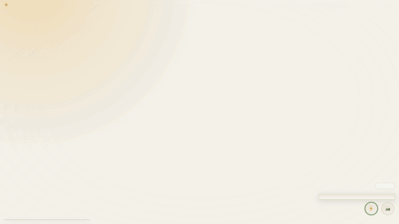
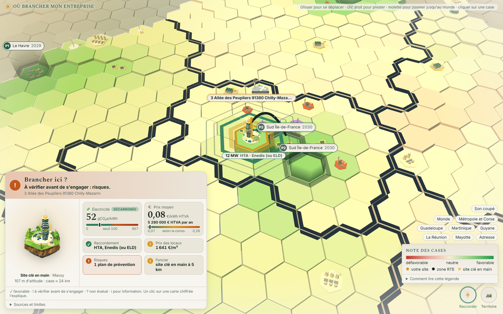
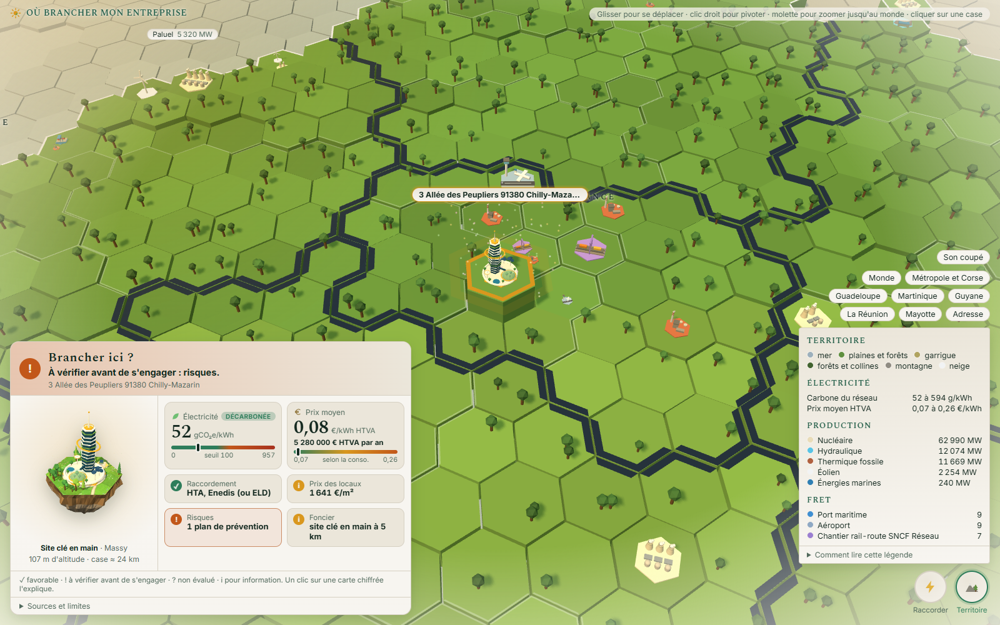
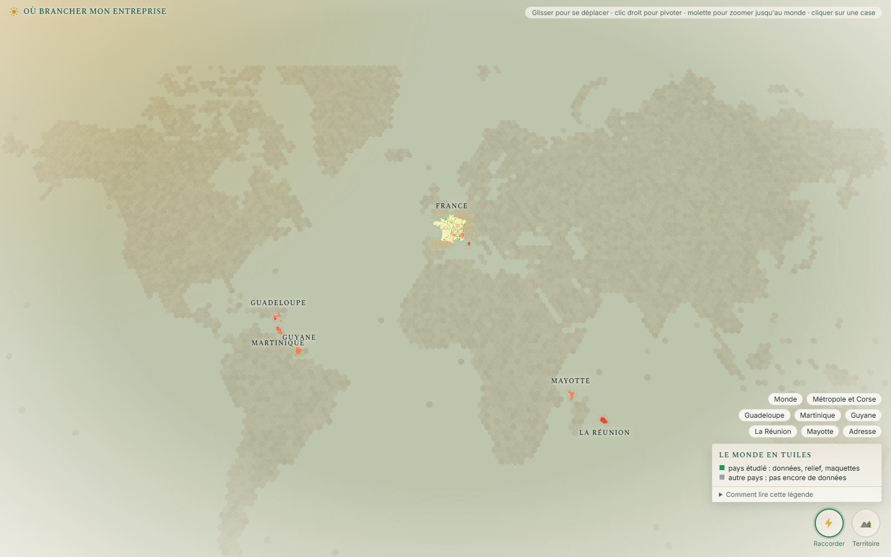
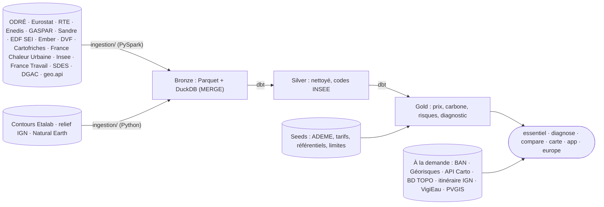

# Où brancher mon entreprise

> **Dire en une commande si un projet de 1 à 50 MW peut se brancher à une adresse française, qui
> le raccordera, dans quel délai et à quel coût, à partir des seules données publiques.**



*L'exemple de référence, un data center de 12 MW et 70 000 MWh par an, détaillé plus bas.*

**Pourquoi maintenant** : plus de 200 projets industriels, près de 33 GW, attendent un raccordement
au réseau haute tension, près de trois fois la consommation actuelle de l'industrie française
([RTE, 3 juillet 2026](https://www.rte-france.com/actualites/2026-07-03-reussir-electrification-france)).
D'ici fin 2026, la file d'attente passe de « premier arrivé » à « premier prêt, premier servi » :
choisir tôt un site raccordable devient un avantage (même source). Et la carte des capacités en
soutirage de RTE est attendue au 1er janvier 2027 (délibération CRE 2026-173) : l'outil l'intégrera
dès sa publication, à côté de ce qu'il rassemble déjà.

**Une adresse française en entrée ; en sortie, la réponse à « puis-je brancher mon entreprise
ici ? »** : qui raccorde et à quelle échéance, les risques de la commune, le carbone du réseau, la
facture et le terrain prêt le plus proche. Données publiques uniquement, chaque chiffre avec sa
source et sa limite. Ligne de commande ou application dans le navigateur, en local. État et suite
du projet : [PLAN.md](PLAN.md).

**Pour qui** : les projets de **1 à 50 MW** (data centers, hubs de bornes de recharge, sites
industriels et logistiques), pour qui la puissance disponible, son délai et le coût de l'électricité
décident du site. Pour des bureaux, le prix de l'électricité est le même partout et ne départage pas
les villes : l'outil n'y apporte rien de décisif.

**Ce que l'outil ne dit pas** (aucune source publique) : la capacité réellement disponible au poste
(seule une étude Enedis ou RTE fait foi ; RTE annonce une carte des capacités en soutirage pour le
1er janvier 2027), le droit effectif à un tarif réduit d'accise (il dépend de conditions propres à
l'exploitant, que l'outil chiffre sans les vérifier), le loyer des locaux, la consommation d'un projet déduite de sa seule puissance. Il dit « non
disponible » plutôt que de deviner.







*La carte générée pour l'exemple de référence : un data center de 12 MW et 70 000 MWh par an au
« 3 allée des Peupliers, 91380 Chilly-Mazarin » (`essentiel --puissance 12 --conso 70000
--activite data-center`, le 29 octobre 2026, captures refaites le 1er novembre). En haut, la vue « Raccorder » (touche 1) : les cases
sont notées du rouge au vert, l'adresse est reliée à la zone prioritaire RTE Sud Île-de-France
(capacité en 2030) et au site clé en main de Massy ; la fiche donne le verdict : raccordement en
HTA chez Enedis, carbone sous le seuil de 100 g, facture d'environ 5,3 M€ HTVA par an (un clic
ajoute l'accise réduite possible, environ 1,1 M€ de moins), foncier avec un site clé en main à
5 km ; seul le plan de prévention des inondations de l'Yvette reste à vérifier. En bas, la vue « Territoire »
(touche 2) : paysage réel, carbone et prix moyen par région, production et fret. En dessous, le
monde (touche 0), d'où la carte plonge vers l'adresse. Diagnostic complet, avec la même tuile :
[en PDF](docs/exemples/implantation_chilly.pdf).*

## Trois faits à connaître

| | Pour le chef d'entreprise | Côté data engineering |
|---|---|---|
| **1. Le prix ne dépend pas de l'adresse** | La péréquation tarifaire rend le prix identique partout, Corse et outre-mer compris : environ 0,075 €/kWh HTVA pour 70 000 MWh par an (tranche IF). C'est la consommation qui fait la facture, pas le site ; seule la part acheminement (TURPE) change avec le domaine de tension. | Les tranches Eurostat `nrg_pc_205` (semestrielles, HTVA) sont jointes à la consommation annuelle ; des scénarios à 3 ans sont calibrés sur les erreurs passées, sans regard vers le futur. |
| **2. Le carbone change d'un facteur 10 à 18 entre systèmes électriques** | 51,9 gCO₂e/kWh sur tout le continent, 594 à 957 en Corse et outre-mer, non interconnectés. Le seuil européen (taxonomie) est 100 : il compte pour un financement vert. Sur une île, l'heure compte aussi : en Corse, 522 g vers 13 h contre 681 g vers 5 h. | Facteurs en cycle de vie de la Base Carbone ADEME, en seed daté ; jointure par système électrique dérivé du code INSEE, jamais par libellé. Profil horaire des îles tiré de la production par filière d'EDF SEI (263 000 heures), calé pour redonner le facteur ADEME annuel. |
| **3. La capacité de raccordement n'est pas publique** | Au-delà de 40 MW, c'est RTE et des délais de 2 à 7 ans. L'outil dit qui raccorde selon la puissance et signale la zone prioritaire RTE la plus proche ; seule une étude Enedis ou RTE fait foi. | Seuils de tension en seed, zones du SDDR 2025 géolocalisées, distance au plus proche dans DuckDB. Quand l'API Géorisques tombe, les risques viennent de l'export GASPAR chargé au `refresh`, qui fournit aussi les plans de prévention de chaque commune. |

## Prise en main (10 minutes)

Il faut Python 3.12 et Java 17 (pour PySpark). Tout tourne sur votre poste, sans compte.

**1. Installer**, une seule fois, dans un terminal PowerShell ouvert dans le dossier du projet :

```powershell
python -m venv .venv
.\.venv\Scripts\python.exe -m pip install -e . dbt-duckdb matplotlib reportlab pytest pytest-cov pytest-httpx pypdf ruff
Copy-Item .env.example .env
```

Pour jouer aussi les tests de l'application dans un navigateur (facultatif, télécharge Chromium,
120 Mo environ) :

```powershell
.\.venv\Scripts\python.exe -m pip install pytest-playwright
.\.venv\Scripts\python.exe -m playwright install chromium
```

**Pour voir l'outil sans rien charger** :

```powershell
.\.venv\Scripts\python.exe -m ingestion.cli demo
```

La commande construit une seule fois, dans `data/demo/`, la base synthétique des tests (une minute
environ, sans réseau), puis répond `essentiel` pour un hub de recharge fictif de 2 MW place
Bellecour à Lyon et ouvre la carte. Les lancements suivants prennent environ deux secondes. **Les
chiffres sont fictifs** et la sortie le dit en première ligne ; seule la carte télécharge les
contours des départements et le relief. Pour de vraies réponses, passez à l'étape 2.

**2. Charger les données publiques** (une vingtaine de minutes : 21 le 8 novembre 2026) :

```powershell
.\.venv\Scripts\python.exe -m ingestion.cli refresh --months 180
```

Rien ne se met à jour tout seul : relancez `refresh` quand vous voulez des données fraîches. Chaque
réponse affiche la date des données utilisées. Une question posée avant ce premier chargement, ou
après un `refresh` interrompu, rappelle la commande à lancer.

**3. Ouvrir l'application**, qui fait tout depuis la carte, sans ligne de commande :

```powershell
.\.venv\Scripts\python.exe -m ingestion.cli app
```

Le navigateur s'ouvre sur `http://127.0.0.1:8770/` et une fenêtre demande l'adresse du site :
1. saisir l'adresse ; « Ajouter une seconde adresse » si vous hésitez entre deux sites (deux au
   plus dans l'application, `compare` en ligne de commande en prend jusqu'à six) ;
2. si vous les connaissez, déplier « Préciser le projet » : puissance, consommation, activité,
   surface, chiffre d'affaires, valeur ajoutée, export CSV de la courbe de charge Enedis ;
   « Diagnostic complet » interroge aussi Géorisques, l'urbanisme, VigiEau, PVGIS et la desserte ;
3. « Analyser » : la carte s'ouvre cadrée sur ce que vous avez saisi, la tuile pour une adresse
   ou deux adresses voisines, la région si elles en occupent deux bouts, le monde si l'une est
   outre-mer. Une adresse ambiguë propose les communes possibles sous son champ ;
4. lire la fiche : pour une adresse, le verdict « Brancher ici ? » et ses cartes chiffrées
   (✓ favorable, ! à vérifier, ? non évalué, i pour information) ; pour deux, les mêmes lignes
   côte à côte, sans classement, et un onglet par adresse ;
5. « Télécharger le rapport PDF » : trois à quatre pages, le verdict puis un dessin et trois
   phrases au plus par critère. « Lire le détail », Markdown et JSON gardent toutes les limites
   méthodologiques ; une copie reste dans `data/reports/`.

« Nouvelle analyse », en haut, rouvre la fenêtre.

Le serveur n'écoute que sur la machine (127.0.0.1) et s'arrête par Ctrl+C. `--port` change le
port.

**Ou poser la question en ligne de commande** pour votre adresse, avec la puissance du projet en
MW et la consommation annuelle en MWh si vous les connaissez :

```powershell
.\.venv\Scripts\python.exe -m ingestion.cli essentiel --adresse "3 allée des peupliers 91380 Chilly-Mazarin" --puissance 12 --conso 70000
```

```
3 Allée des Peupliers 91380 Chilly-Mazarin
Commune Chilly-Mazarin (91161) · Essonne (91) · Île-de-France (11)
Données chargées le 28/10/2026.

Prix moyen : 0,0754 €/kWh HTVA, soit environ 5 280 000 € par an pour 70 000 MWh (tranche IF ; Eurostat, S2 2025 – S1 2026)
Acheminement : environ 1 370 000 € HTVA par an, soit 19,6 €/MWh, déjà compris dans le prix moyen (TURPE 7 HTA, longue utilisation, la moins chère ici ; 12 000 kVA souscrits, puissance constante)
Électricité décarbonée : oui (France continentale), 51,9 gCO₂e/kWh en cycle de vie, sous le seuil de 100 gCO₂e/kWh
Locaux d'activité : 1 641 €/m² à la vente à Chilly-Mazarin (médiane de 48 ventes, quartiles 898 à 2 597 ; dernière vente en 12/2025 ; DVF)
À savoir : Le prix ne dépend pas de l'adresse mais de la consommation (péréquation, Corse et outre-mer compris). […]
Brancher ici ? À vérifier avant de s'engager : risques.
```

Un projet de 12 MW (un petit data center, un hub de recharge poids lourds) se raccorde en HTA chez
Enedis ; au-delà de 20 MW, RTE devient probable et les délais s'allongent.

Avec l'export de votre **courbe de charge** (CSV téléchargé depuis votre espace client
Enedis), l'outil prend votre vraie consommation : volume annuel, pointe de puissance (donc qui
raccorde), part en heures creuses, coût au tarif HP/HC actuel et carbone de vos heures de
consommation. Le coût au tarif HP/HC n'est chiffré que jusqu'à 36 kW ; au-delà, aucun prix
horaire n'est public : l'énergie reste au prix moyen de la tranche et la courbe sert au volume, à
la pointe et à l'acheminement. Un exemple est fourni pour essayer : septembre 2026 d'un site
industriel de 12 MW en pointe, tiré de la journée type mesurée par Enedis pour l'industrie (points
de plus de 250 kVA, jours ouvrés et week-ends) et mis à l'échelle, pas la courbe d'un vrai site :

```powershell
.\.venv\Scripts\python.exe -m ingestion.cli essentiel --adresse "3 allée des peupliers 91380 Chilly-Mazarin" --courbe docs/exemples/courbe_industrie_septembre.csv --activite industrie
```

**4. Ouvrir la carte** `data/reports/carte.html` dans un navigateur : l'adresse y est épinglée et
la fiche « Brancher ici ? » détaille les cinq critères. Une adresse ambiguë (deux communes
possibles) est refusée avec les candidats : précisez le code postal.

## Commandes

Toutes s'écrivent `.\.venv\Scripts\python.exe -m ingestion.cli <commande>`.

| Commande | Effet |
|---|---|
| `essentiel --adresse "…" [--puissance MW] [--conso MWh] [--activite data-center\|irve\|industrie\|logistique] [--courbe CSV] [--ca €] [--va €] [--surface m²] [--format json]` | Réponse courte : prix, carbone, prix de vente des locaux d'activité (DVF) et verdict « brancher ici ? » ; avec `--puissance` et `--conso` au-delà de 36 kVA, la part acheminement (TURPE 7) de la facture ; `--courbe` lit l'export Enedis, `--ca` donne la part de la facture dans le chiffre d'affaires, `--va` l'électro-intensité fiscale (taux réduit d'accise dès 0,5 % de la valeur ajoutée), `--activite` le profil de charge (journée type mesurée par Enedis pour l'industrie, puissance constante sinon) et le régime d'accise de l'activité ; avec `--va` ou `--activite`, l'accise au tarif réduit de la loi de finances 2026 face au tarif normal (10 €/MWh au-delà du premier GWh pour un data center, 5,5, 3 ou 0,5 €/MWh selon le palier d'électro-intensité pour l'industrie), sous conditions |
| `diagnose --adresse "…" [--puissance MW] [--conso MWh] [--activite data-center\|irve\|industrie\|logistique] [--courbe CSV] [--ca €] [--va €] [--surface m²] [--format pdf\|md\|json]` | Diagnostic complet : industrie locale, réseau, raccordement (dont la qualité de fourniture du département), prix, acheminement, carbone, risques et sismicité, voisinage (argiles, cavités à 500 m, Seveso à 5 km, installations classées à 1 km, sols pollués à 500 m), foncier (zone d'urbanisme, friches à moins de 10 km, zones d'activité à moins de 5 km, réseaux de chaleur à moins de 10 km, débouché de la chaleur fatale d'un data center, prix des locaux), eau (arrêtés de restriction du jour, zone de répartition des eaux), desserte (temps vers le fret, autoroute), main-d'œuvre (diplômés à moins de 45 min en voiture, recrutements techniques du département), bâtiment et productible solaire, obligations de solarisation (toiture neuve ou existante, parking extérieur), puis le verdict « brancher ici ? » critère par critère ; `--sans-risques` coupe tous les appels à la demande (Géorisques, urbanisme, eau, solaire, desserte, zones d'activité, isochrone de la main-d'œuvre) |
| `compare --adresse "A" --adresse "B" … [mêmes options que diagnose]` | 2 à 6 adresses côte à côte, sans classement, avec le prix des locaux, une ligne courte par source consultée à la demande (zonage, friches, réseau de chaleur le plus proche, zones d'activité, accès routier, bâtiment et solaire, eau, risques ; « — » pour l'adresse qui ne l'a pas été), le parking et la toiture à solariser et le verdict « brancher ici ? » de chacune ; `texte`, `md`, `csv`, `json` |
| `app [--port 8770] [--sans-ouvrir]` | Application locale dans le navigateur : fenêtre d'accueil pour une ou deux adresses et le projet (courbe de charge comprise), carte cadrée sur les adresses, verdict ou comparaison côte à côte, rapport PDF en un clic, Markdown ou JSON |
| `carte [--adresse "…"] [--puissance MW] [--reconstruire] [--sans-ouvrir] [--output FICHIER]` | Carte 3D hors ligne (`data/reports/carte.html` par défaut) |
| `demo [--sans-ouvrir]` | Démonstration sans `refresh` : `essentiel` et la carte sur la base synthétique des tests (`data/demo/`), chiffres fictifs dits comme tels |
| `europe --adresse "…" [--conso MWh]` | Hors de France, dans l'UE : prix moyen du pays et carbone de sa production, comparés à la France à tranche égale (moyennes nationales) |
| `refresh [--months 180]` | Met à jour toutes les sources, puis `dbt build` |
| `tempo --month 2026-09` | Charge le calendrier Tempo du mois depuis l'API RTE (compte RTE requis, hors `refresh`) |
| `ecowatt` | Relève le signal Ecowatt du jour à J+3 (API RTE, compte Ecowatt requis, hors `refresh`) ; le rapport mensuel compte les jours orange et rouges relevés |
| `report --month 2026-09` | Rapport mensuel carbone et créneaux Tempo, après `tempo` pour le même mois ; prix Tempo connus depuis le 1er février 2026 |

Pour l'entretien des données, sans besoin au quotidien : `geocode` résout une adresse ; `freshness` et `coverage` contrôlent le retard et la complétude d'un
jeu ; `extract`, `load`, `ingest` et `consolidate` extraient, chargent ou relisent un jeu ; `prix`
charge les prix Eurostat. `--help` après une commande donne ses options, dont `--output` pour
choisir le fichier et `--sans-graphiques` pour un rapport sans images.

Les commandes qui répondent à une question (`essentiel`, `diagnose`, `compare`, `carte`, `europe`)
n'affichent que la réponse, les alertes et le chemin des fichiers écrits ; `--verbose`, avant ou
après la commande, montre le journal technique. `essentiel` et `diagnose` épinglent aussi leur
adresse sur la carte (`--sans-carte` pour s'en passer ; `carte --sans-ouvrir` écrit la page sans
lancer le navigateur). La carte n'est refaite que si le warehouse, les contours ou le gabarit sont
plus récents qu'elle ; sinon seule l'épingle et son verdict changent.

**La carte** s'ouvre sur le monde en tuiles (touche 0, ou la molette en reculant) : chaque pays y
est fait de tuiles d'environ 200 km, ternes et sans donnée, sauf les pays étudiés. Pour l'instant,
la France : la métropole avec la Corse et les cinq départements d'outre-mer, chacun à sa place sur
le monde et agrandi en cases fines. Les collectivités d'outre-mer (Nouvelle-Calédonie, Polynésie…)
n'ont pas de données et restent ternes. Contours des pays : Natural Earth, frontières de fait, sans
valeur officielle ; aucun chiffre n'en sort. Ajouter un pays : son code dans `PAYS_ETUDIES`
(`ingestion/hexagones.py`) et sa grille de cases.

Avec une adresse, la terre part sèche ; la carte plonge du monde vers sa case, où un bâtiment au
liseré doré marque le site, puis une vague reverdit la carte depuis l'adresse et sa tuile vient se
ranger dans la fiche. La tuile est un îlot détaillé : relief, sol peint, flancs de roche, arbres
qui poussent, maquettes. Couleur, relief et maquettes viennent des données ; parcelles, chemin,
arbres et fleurs sont un décor, pas un plan du site. À droite, on lit le verdict d'un coup d'œil :
carbone et prix en jauges, puis raccordement, prix des locaux, risques et foncier, « non
disponible » si l'indicateur manque. Un clic sur une carte chiffrée ouvre son détail ; « Sources et
limites » se déplie sous la fiche. Le PDF porte une tuile dessinée en vectoriel
(`reporting/tuile.py`), puis une fiche par critère : échelle des domaines de tension, jauge du
carbone, parts de la facture, distances et prix des locaux (`reporting/visuels.py`). Il ne garde
que la limite qui pèse sur chaque critère, avec un conseil ; toutes les limites restent dans les
sorties texte, Markdown et JSON. Un clic sur une case fait sortir sa tuile à côté de la fiche du
département. Le bouton « Son », coupé à l'ouverture, donne à la tuile ouverte une ambiance
discrète : bourdonnement à 50 Hz pour une centrale thermique ou nucléaire, souffle pour l'éolien,
eau pour l'hydraulique, ressac pour les énergies marines, quand cette filière porte plus de la
moitié de la puissance en service sur la case ; sinon, ou pour le solaire, rien. Les sons sont
synthétisés dans la page (aucun fichier) et ne disent rien que la fiche ne dise. Les boutons en bas à droite
passent d'une carte à l'autre. Deux vues (touches 1 et 2). « Raccorder », par défaut : chaque
case de 24 km est notée du rouge (défavorable) au vert (favorable) en passant par le blanc (neutre),
selon la proximité d'une zone prioritaire RTE et d'un site clé en main France 2030, les postes
400 kV, les contraintes RTE prévues, le relief, le carbone et l'équilibre régional ; zones RTE
(anneau et bannière avec l'année de capacité), sites clés en main (maquette de hangar au drapeau doré), centrales en maquettes et adresse reliée
à la zone RTE utile et au site le plus proche. Seule cette vue porte des fausses couleurs.
« Territoire » montre le paysage réel : mer en bleu, plaines et forêts en vert, garrigue, montagnes
grises et sommets enneigés, hauteur selon l'altitude IGN. Des bosquets y poussent : feuillus en plaine,
conifères en altitude, oliviers en garrigue, jamais sur une case qui porte une maquette. Son encart donne le carbone du réseau
(pastille « décarbonée » sous 100 g/kWh) et le prix moyen HTVA des entreprises, identique partout,
de la plus petite à la plus grosse tranche de consommation. Elle porte aussi les pôles de production
d'au moins 200 MW sur le continent et 20 MW en Corse et outre-mer (registre national), en maquettes
par filière (réacteurs et tours aéroréfrigérantes, barrage-voûte et sa retenue, chaudière et
cheminée) qui ne dépassent pas les deux tiers de la case. Les deux vues portent enfin les grands
pôles de fret, pour juger la desserte d'une région : ports d'au moins 5 Mt de marchandises par an
hors tare (0,5 Mt en Corse et outre-mer, SDES), aéroports d'au moins 20 000 t de fret et de poste
(3 000 t, DGAC), en maquettes de quai à portique et d'aérogare avec avion cargo ; chantiers
rail-route de SNCF Réseau d'au moins 2 km de voies de manutention, en maquette de voie, wagons et
portique. Pour le rail, la longueur de voies est un repère de capacité : aucun tonnage n'est publié.
Un clic sur une case affiche la fiche du département ; le survol d'une case donne sa note et ses
raisons, celui d'un pôle sa puissance et sa production, celui d'un pôle de fret son tonnage.

**Identifiants** (`tempo` et `ecowatt` seulement, deux comptes RTE distincts) : copiez
`identifiants.exemple.txt` en `identifiants.local.txt`. Ce fichier est ignoré par git et prime sur
`.env`. Les autres commandes n'en demandent aucun.

## Architecture



- **Ingestion idempotente en PySpark** : chaque lot est typé et normalisé par une session Spark
  locale (UTC, changements d'heure, clés complètes), puis écrit via Arrow ; BOM, codes IRIS
  tronqués et secret statistique sont traités en Python. Le bronze garde toutes les révisions en
  Parquet immuables (`data/bronze/<jeu>/ingest_date=…/part-<run_id>.parquet`, suffixé `-2`, `-3`… plutôt qu'écrasé si le même `run_id` revient le même jour), puis un `MERGE`
  sur clé dans DuckDB (`data/warehouse/eco2mix.duckdb`) : relancer ne duplique rien. Quota d'API
  suivi, bascule sur l'export CSV, nouvelles tentatives exponentielles.
- **Silver et gold en dbt-duckdb**, reconstruits à chaque run (quelques secondes). Jointures par
  code INSEE ; énergie = puissance × durée (jours de 23 ou 25 h) ; verdict carbone en cycle de vie.
- **Étoile** (schéma `etoile`, `dbt/models/etoile/`) : modèle dimensionnel bâti sur le gold, pour
  l'analyse en SQL ou en outil de BI, et lu par le diagnostic là où le grain existe.
  Dimensions `dim_commune` (commune, département, région aplatis, centre de la commune),
  `dim_departement_region`, `dim_date` (1930-2035), `dim_risque` et `dim_naf` ; faits
  `fait_conso_entreprises` (commune × année), `fait_prix_locaux` (commune), `fait_risque_commune`
  (commune × risque), `fait_plan_prevention` (commune × procédure), `fait_diplomes_commune`
  (commune), `fait_recrutements_techniques` et `fait_continuite_departement` (département),
  `fait_mix_journalier` (jour). Les clés étrangères sont contrôlées par des tests `relationships`.
  `diagnose` lit dans l'étoile les entreprises de la commune, les risques et les plans de
  prévention, la continuité, les recrutements et les diplômés ; les tables sans grain commune,
  département ou jour (polygones, distances, repli de la commune sur le département) restent
  lues dans le gold.
- **Gold principal** : `fct_diagnostic_territoire` (une ligne par département),
  `fct_prix_entreprise_tranche`, `fct_carbone_territoire`, `fct_carbone_horaire_zni`,
  `fct_risques_commune`, `fct_plans_prevention_commune`, `fct_zonage_sismique`, `fct_prix_locaux`, `fct_sites_production`, `fct_poles_fret`, `fct_pays_ue`,
  `fct_mix`, `fct_conso_entreprises_commune` et `fct_conso_entreprises_adresse` (entreprises
  raccordées à Enedis, dernière année publiée). Les seeds datés (tarifs, accise, grille TURPE 7, SDDR, sites clés en main, facteurs ADEME) sont à mettre à jour à chaque
  nouvelle source et recréés à chaque `dbt build` ; `limites_methodologiques` porte la limite de chaque indicateur.
- **Acheminement** : la grille TURPE 7 HTA-BT (délibération CRE 2026-105) et HTB 1 à 3 (2026-104, appliquée dès 40 MW avec
  HTB 1 par défaut), seeds `turpe_soutirage` et `turpe_gestion_comptage`, chiffre la part réseau de la facture selon
  le domaine de tension : puissance souscrite, énergie répartie par classe temporelle (pointe,
  heures pleines et creuses, saison haute ou basse) sur la courbe de charge ou, à défaut, sur
  toutes les heures de l'année, version courte, moyenne ou longue utilisation retenue au moindre coût
  (`ingestion/turpe.py`). La HTB a son propre calendrier (délibération CRE 2025-77) : week-ends et
  jours fériés creux, plages changées au 1er janvier 2027, Nouvelle-Aquitaine et Occitanie à part.
- **Fiabilité** : géocodage BAN sur cinq candidats, adresse refusée si trop approximative ou
  ambiguë ; projet refusé si la consommation dépasse ce que la puissance permet en un an ; consommation Enedis cherchée à l'adresse seulement quand la BAN la trouve au numéro
  près (clé « numéro + voie » sans accents ni ponctuation, « 13 bis » = « 13 B ») ; date des données affichée partout, avec alerte au-delà de 45 jours ; risques en repli
  local quand l'API Géorisques ne répond pas. Les risques ne sont « à vérifier » que si un plan de
  prévention (PPRN, PPRT, PPRM) approuvé ou prescrit couvre la commune, soit 13 919 communes : un
  risque seulement recensé, ce qui touche 31 706 communes, est donné pour information. La zone de
  sismicité réglementaire (1 à 5) vient de la couche WFS de Géorisques, chargée par `refresh` :
  36 719 polygones des communes de 2010, triés par `gid` pour une pagination stable et comptés
  contre le total annoncé ; l'adresse est située dans son polygone, ce qui reste juste dans une
  commune nouvelle. Le voisinage (argiles, cavités, Seveso, installations classées, sols pollués)
  vient des mêmes API Géorisques, à la demande, et complète le détail du critère sans en changer
  l'état.
- **Sources à la demande** : ce qui dépend du point et change sans prévenir (zone d'urbanisme,
  arrêtés sur l'eau, zones d'activité, itinéraires, isochrone, bâtiment, productible solaire) est appelé au
  moment de la question, jamais stocké ; un appel qui échoue est signalé dans sa section sans
  bloquer le reste du diagnostic.
- **Main-d'œuvre** : les diplômés (supérieur, puis CAP-BEP ou bac) des communes dont le centre est
  dans l'isochrone de 45 minutes en voiture de l'adresse (Géoplateforme, à la demande) sont sommés
  à partir de la base Diplômes-Formation de l'Insee ; les projets de recrutement des métiers de
  l'électricité, du froid et de la maintenance (seed `metiers_techniques_bmo`) viennent de
  l'enquête BMO de France Travail, ramenée au département faute de table du bassin d'emploi vers
  la commune. Une ligne d'information, sans effet sur le verdict.
- **Prix des locaux** : les ventes de locaux d'activité des cinq dernières années publiées (DVF, un fichier de ~100 Mo par année, lu en flux) donnent la médiane au m² par commune, le département en repli sous 5 ventes ; DVF ne sépare pas les bureaux des commerces et entrepôts, ne contient aucun loyer et ignore l'Alsace, la Moselle et Mayotte.
- **Charte** : couleurs et polices de la carte, du PDF et des graphiques viennent d'un seul module,
  `reporting/charte.py` (papier clair, encre vert nuit, titres verts, vert pour le favorable, orange pour « à
  vérifier » ; Spectral pour les titres, Inter pour le texte et les chiffres). Les polices,
  versionnées dans `reporting/polices/`, sont tirées des fichiers Google Fonts par fontTools,
  réduites au latin et aux symboles des sorties (₂, ≥, →) ; Inter est un instantané de la police
  variable (`--update-name-table`, sinon le gras garde le nom « Inter-Regular ») :
  `python -m fontTools.varLib.instancer "Inter[opsz,wght].ttf" wght=700 opsz=14 --update-name-table -o Inter-700.ttf`,
  puis `python -m fontTools.subset Inter-700.ttf --unicodes="U+0020-007E,U+00A0-017F,U+2000-206F,U+2070-209F,U+20AC,U+2190-21FF,U+2200-22FF" --layout-features="kern,liga,tnum,lnum" --output-file=reporting/polices/Inter-Bold.ttf`.
- `data/` n'est pas versionné et se recrée par `refresh`. DuckDB n'accepte qu'un writer : fermez
  toute session `duckdb` pendant un chargement.

## Tests

```powershell
.\.venv\Scripts\python.exe .claude/scripts/verifier.py
```

Le script joue `ruff`, `pytest`, puis un essai réel (warehouse et réseau requis) : cinq cas en un
quart de minute, chacun avec ce qu'il attend (domaine de tension, raccordement, système
électrique) : `essentiel` à 12 MW à Chilly-Mazarin, `diagnose` à 45 MW, `compare` de deux adresses,
une adresse en Corse et un appel à `/api/analyse` de l'application. `--rapide` saute `pytest`,
`--sans-essai` saute l'essai réel, `--complet` y ajoute un `diagnose` avec les sources à la
demande et nomme celle qui ne répond pas. 945 tests sans réseau, dont un
`dbt build` complet sur une base synthétique qui reproduit les pièges des sources, plus les tests de
données dbt. La couverture est mesurée à chaque run complet (`pytest --cov`, lignes et branches : 94,6 % le 10 novembre 2026) et la suite échoue sous 92,5 %. Une matrice joue chaque activité à chaque palier de puissance, dans chaque territoire et chaque format, par la vraie ligne de commande, et chaque source à la demande est jouée contre huit pannes. Les sorties de `essentiel`, `diagnose` et `compare` sont comparées à des références figées (`ingestion/tests/references/`) : après un changement de libellé voulu, `pytest ingestion/tests/test_references.py --maj-references` les réécrit, et leur diff se relit avant de commiter. Sept parcours de l'application sont joués dans Chromium par `pytest-playwright` (`test_navigateur.py`, sautés si le paquet n'est pas installé) contre le vrai serveur et la base synthétique, réseau coupé : accueil, adresse, verdict et PDF ; adresse ambiguë ; deux adresses, tableau et CSV ; courbe gardée puis retirée ; serveur arrêté ; page ouverte en `file://` ; bouton « Son » et règle de la filière dominante. Toute erreur de console ou requête hors de la machine fait échouer le parcours. La CI GitHub Actions joue `ruff` et `pytest` à chaque PR.

## Sources et licence

[ODRÉ](https://odre.opendatasoft.com) (éCO2mix, RTE) · [Eurostat](https://ec.europa.eu/eurostat) ·
[Base Carbone de l'ADEME](https://data.ademe.fr/datasets/base-carboner) ·
[Base Adresse Nationale](https://adresse.data.gouv.fr) · [Géorisques, GASPAR, zonage sismique, installations classées et sols pollués](https://www.georisques.gouv.fr) · [Géoportail de l'urbanisme (API Carto)](https://apicarto.ign.fr) ·
[contours Etalab](https://etalab-datasets.geo.data.gouv.fr/contours-administratifs/) ·
[altimétrie IGN](https://geoservices.ign.fr/documentation/services/services-geoplateforme/altimetrie) ·
[Natural Earth](https://www.naturalearthdata.com) (terres et pays, domaine public) ·
[sites clés en main France 2030](https://www.data.gouv.fr/datasets/les-sites-cles-en-main-france-2030) ·
[consommation des entreprises par adresse d'Enedis](https://opendata.enedis.fr/datasets/consommation-annuelle-entreprise-par-adresse) ·
[continuité d'alimentation d'Enedis](https://opendata.enedis.fr/datasets/indicateur-continuite-dalimentation) ·
[EDF SEI](https://opendata.edf.fr/datasets/courbe-de-charge-de-la-production-delectricite-par-filiere) ·
[Ember](https://ember-energy.org/data/yearly-electricity-data/) (CC BY 4.0) ·
[registre national des installations de production](https://odre.opendatasoft.com/explore/dataset/registre-national-installation-production-stockage-electricite-agrege/) ·
[geo.api.gouv.fr](https://geo.api.gouv.fr) ·
[trafic maritime du SDES](https://www.data.gouv.fr/datasets/maritime-transport-de-marchandises) ·
[trafic aérien commercial de la DGAC](https://www.data.gouv.fr/datasets/64808a5811da153f1439914c) ·
[chantiers de transport combiné de SNCF Réseau](https://www.data.gouv.fr/datasets/chantiers-de-transport-combines) (ODbL) ·
[ventes immobilières DVF](https://www.data.gouv.fr/en/datasets/dvf) (DGFiP, Licence Ouverte 2.0) ·
[Cartofriches](https://cartofriches.cerema.fr) (Cerema, Licence Ouverte 2.0) ·
[Tracés des réseaux de chaleur et de froid](https://www.data.gouv.fr/datasets/64f05d3568e4d575eb454ffe) (France Chaleur Urbaine, Licence Ouverte 2.0) ·
[base Diplômes-Formation du recensement](https://www.insee.fr/fr/statistiques/9006527) (Insee, Licence Ouverte 2.0) ·
[enquête Besoins en main-d'œuvre](https://www.data.gouv.fr/datasets/561fa564c751df4f2acdbb48) (France Travail, Licence Ouverte) ·
[BD TOPO et calcul d'itinéraire de la Géoplateforme](https://geoservices.ign.fr) (IGN, Licence Ouverte) ·
[VigiEau](https://vigieau.gouv.fr) (ministère de la Transition écologique) ·
[zones de répartition des eaux du Sandre](https://www.sandre.eaufrance.fr/atlas/srv/api/records/e5325942-18f6-472c-973a-1f35bb207eb0) (référentiel ZRPE, Licence Ouverte) ·
[PVGIS](https://joint-research-centre.ec.europa.eu/photovoltaic-geographical-information-system-pvgis_en) (JRC, Commission européenne) ·
[profils de charge > 36 kVA d'Enedis](https://opendata.enedis.fr) · [API Tempo et Ecowatt de RTE](https://data.rte-france.com) ·
[Nominatim](https://nominatim.openstreetmap.org), données © contributeurs OpenStreetMap (ODbL) ·
SDDR 2025 de RTE · barèmes et grille TURPE 7 de la CRE ·
[code de la construction et de l'habitation, art. L171-4 et L171-5](https://www.legifrance.gouv.fr/codes/article_lc/LEGIARTI000043963538) et [loi APER, art. 40](https://www.legifrance.gouv.fr/loda/id/JORFTEXT000047294244) (Légifrance) pour les obligations de solarisation ·
[code des impositions sur les biens et services](https://www.legifrance.gouv.fr/codes/section_lc/LEGITEXT000044595989/LEGISCTA000044598507/) (Légifrance) et
[formulaire 2040-TIC-SD](https://www.impots.gouv.fr/sites/default/files/formulaires/2040-tic-sd/2026/2040-tic-sd_5321.pdf) (DGFiP) pour l'accise.

Code sous [licence MIT](LICENSE) ; les données restent sous la licence de leurs producteurs.
[three.js](https://threejs.org) r128, embarqué dans `reporting/vendor/`, est sous licence MIT.
Les polices [Spectral](https://github.com/productiontype/Spectral) (Production Type) et
[Inter](https://github.com/rsms/inter), embarquées dans `reporting/polices/`, sont sous licence
SIL Open Font License 1.1 (fichiers `OFL-*.txt`).
