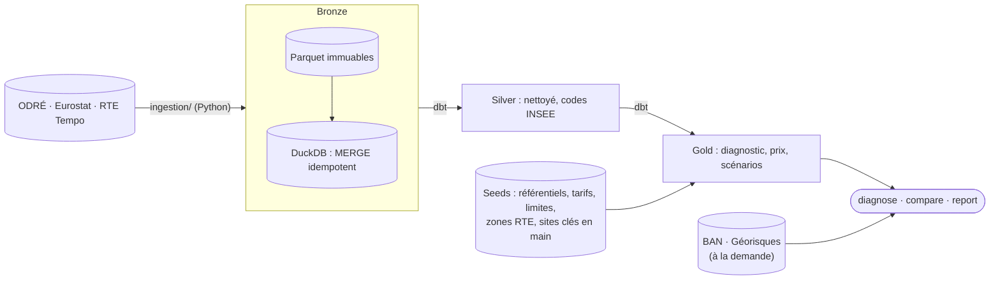

# Où brancher mon entreprise

**Prix et carbone de l'électricité à une adresse française.** Une adresse en entrée ; en
sortie, le prix moyen de l'électricité pour l'entreprise et si l'électricité du réseau y est
décarbonée, puis, si on le souhaite, un diagnostic d'implantation complet (réseau, prix,
risques), chaque chiffre accompagné de sa limite. Une commande, pas d'application.

```bash
uv run python -m ingestion.cli essentiel --adresse "1 cours Napoléon, 20000 Ajaccio" --conso 60000
```

```
1 Cours Napoléon 20000 Ajaccio
Commune Ajaccio (2A004) · Corse-du-Sud (2A) · Corse (94)

Prix moyen : 0,0916 €/kWh HTVA, soit environ 5 500 000 € par an pour 60 000 MWh (tranche IE ; Eurostat, S2 2025 – S1 2026)
Électricité décarbonée : non (Corse), 594 gCO₂e/kWh en cycle de vie, au-dessus du seuil de 100 gCO₂e/kWh
À savoir : Le prix ne dépend pas de l'adresse mais de la consommation (péréquation, Corse et outre-mer compris). […]
```

Exemples réels : [recette sur 11 adresses](docs/exemples/recette_mvp.md) ·
[diagnostic de Lyon](docs/exemples/implantation_lyon.md) ([PDF](docs/exemples/implantation_lyon.pdf)) ·
[comparaison Lyon, Lille, Poitiers](docs/exemples/comparaison_lyon_lille_poitiers.md).

## Ce que dit le diagnostic

| Bloc | Indicateurs | Source | Maille |
|---|---|---|---|
| 1. Pression industrielle | Sites raccordés au transport et leur consommation ; rang du département | ODRÉ (RTE, GRTgaz, Teréga) | commune, département |
| 2. Tension du réseau | Couverture production / consommation sur 12 mois, rang de dépendance ; contraintes d'évacuation ; contraintes prospectives RTE à 3-5 ans | ODRÉ (RTE) | région, département |
| 3. Raccordement | Niveau de tension et gestionnaire selon la puissance ; postes RTE ; zone prioritaire RTE la plus proche et sa date de capacité ; site industriel clé en main le plus proche | arrêté de 2003, ODRÉ, SDDR 2025 de RTE, ANCT | adresse, département |
| 4. Prix | Prix de la tranche de consommation sur 12 mois, repères depuis 2007, scénarios à 3 ans et leur contrôle sur le passé | Eurostat `nrg_pc_205` | national, par tranche |
| 5. Carbone et coût d'un profil type | Électricité décarbonée ou non (seuil de 100 gCO₂e/kWh de la taxonomie européenne) ; bureau 36 kVA chiffré heure par heure (HP/HC), gain d'un report vers les heures creuses | ADEME Base Carbone, CRE, éCO2mix | système électrique (continent, Corse, chaque DROM) ; national |
| 6. Risques | Risques naturels et technologiques à l'adresse ; repli sur la commune si le rapport ne répond pas | Géorisques | adresse |

**Les limites tiennent au cadrage**, établi dans [`docs/cadrage-besoins-entreprises.md`](docs/cadrage-besoins-entreprises.md) :

- **le prix n'est pas géographique** : la péréquation rend le tarif identique partout. Il
  dépend de la taille de l'entreprise, pas de l'adresse ;
- **le carbone ne change qu'entre systèmes électriques** : le continent est un seul réseau
  (51,9 gCO₂e/kWh en cycle de vie, ADEME 2024) ; seules la Corse et l'outre-mer, non
  interconnectés, ont leur propre facteur, six à dix-huit fois plus élevé ;
- **la capacité de raccordement en soutirage n'est pas en open data** : seule une étude RTE ou
  Enedis fait foi.

Chaque indicateur affiche donc sa source, sa maille et ce qu'il ne dit pas
(`dbt/seeds/limites_methodologiques.csv`) : une exigence de méthode, et de conformité aux
règles sur les allégations environnementales (directive EmpCo).

## Utilisation

| Commande | Effet |
|---|---|
| `essentiel --adresse "…" [--conso N] [--format json]` | Prix moyen et verdict carbone, en 5 lignes ; sans `--conso`, tranche des petites entreprises (IA, moins de 20 MWh par an) |
| `diagnose --adresse "…"` | Diagnostic complet dans le terminal, l'essentiel en tête |
| `… --puissance 12` | Niveau de tension et gestionnaire pour un projet de 12 MW |
| `… --conso 60000` | Prix de la tranche Eurostat pour 60 000 MWh par an |
| `… --format pdf\|md\|json [--output fichier]` | Rapport PDF ou Markdown (graphiques compris), ou JSON |
| `… --sans-risques` | Sans appel à Géorisques (hors ligne) |
| `compare --adresse "A" --adresse "B" …` | 2 à 6 adresses côte à côte, **sans classement** ; formats `texte`, `md`, `csv` (Excel), `json` |
| `refresh [--months 180]` | Rafraîchit toutes les sources puis lance `dbt build` (180 mois au premier chargement) |
| `geocode --adresse "…"` | Résolution de l'adresse seule (BAN), score et précision |
| `report --month 2026-09 [--format md]` | Rapport mensuel carbone et créneaux Tempo (voir plus bas) |

Toutes les commandes : `uv run python -m ingestion.cli <commande>`.

## Installation

Python 3.12 et [uv](https://docs.astral.sh/uv/). Tout tourne en local, sans service cloud ni
compte (sauf le calendrier Tempo, optionnel).

```bash
uv sync --group dev --group dbt --group report
cp .env.example .env

# Données : une dizaine d'appels API, puis dbt build (une minute environ)
uv run python -m ingestion.cli refresh --months 180          # éCO2mix depuis 2012, territoire, prix
```

`refresh` enchaîne l'éCO2mix consolidé puis temps réel, les cinq jeux territoriaux, les prix
Eurostat et `dbt build` ; chaque étape existe aussi seule (`consolidate`, `ingest --dataset`,
`prix`).

La BAN (géocodage) et Géorisques sont appelés au moment du diagnostic ; `essentiel` n'appelle
que la BAN.

## Architecture



| Couche | Construite par | Règle |
|---|---|---|
| Bronze (`data/bronze/*.parquet` + schéma `bronze`) | `ingestion/` | Miroir de la source, horodatage en UTC ; les Parquet gardent toutes les révisions, les tables la dernière |
| Silver | `dbt/models/silver/` | Nettoyage et conformité (codes INSEE, classes ordonnées), pas d'agrégat |
| Gold | `dbt/models/gold/` | Prêt à lire : une requête par diagnostic, unités dans les noms de colonnes |

Choix structurants :
- **DuckDB, pas de PySpark** : le plus gros jeu fait 500 000 lignes, la base 235 Mo ; un
  `dbt build` complet (229 nœuds, tests compris) prend une dizaine de secondes.
- **Reconstruction complète** de silver et gold à chaque run : plus simple qu'un incrémental
  à ce volume.
- **Interface `WarehouseLoader`** : seul point où DuckDB est nommé, pour une bascule BigQuery
  ultérieure (`BigQueryLoader` à écrire).

Détail des modèles : [`dbt/README.md`](dbt/README.md) ; stockage : [`data/README.md`](data/README.md).

## Fiabilité des données

- **Changements d'heure** : `date_heure` normalisé en UTC dès l'extraction ; l'heure de mars
  inexistante lève une erreur, l'heure d'octobre doublée est tranchée par l'instant précédent.
  RTE publie 24 h par jour : 4 lignes en double par an absorbées, 1 h manquante par an signalée
  (`est_complet = false`).
- **Révisions** : fenêtre glissante de 3 h, dédoublonnage du lot, MERGE sur la clé (jamais
  d'INSERT) ; une clé peut être composite et comporter des colonnes optionnelles.
- **Quota ODRÉ** (50 000 appels par jeu et par mois) : environ 900 appels par mois en
  exploitation horaire, journalisés avec le compteur renvoyé par l'API ; bascule automatique
  sur l'export CSV (un appel) au-delà de 900 lignes.
- **Pièges des sources**, traités et testés : BOM des exports CSV, ligne temps réel publiée
  « à blanc », codes IRIS tronqués, communes non publiées, millésimes masqués par le secret
  statistique (millésime retenu : 2021), champs géographiques vides des contraintes RTE.
- **API instables** : nouvelles tentatives exponentielles partout ; Géorisques coupe souvent
  ses connexions, d'où un repli communal annoncé, et un diagnostic qui sort même sans lui.

## Exploitation

**MVP : `refresh` chaque semaine.** Le workflow [`refresh.yml`](.github/workflows/refresh.yml)
le lance chaque lundi sur les vraies API, garde le warehouse en cache, vérifie Lyon (décarbonée)
et Ajaccio (non décarbonée) sur la vraie base, et publie la base en artefact : un run rouge
signale une source en panne ou qui a changé. En local, une tâche planifiée suffit, par exemple
sous Windows, dans l'invite de commandes :

```bat
schtasks /create /tn "Ou brancher - refresh" /sc weekly /d MON /st 06:00 /tr "uv --directory \"C:\chemin\du\depot\" run python -m ingestion.cli refresh"
```

Une source en échec n'arrête pas les autres : sa dernière version reste en bronze, et la
commande sort en code 1.

**Plus tard : Airflow.** Trois DAGs Airflow (projet Astro dans `airflow/`, `astro dev start`) : ingestion horaire,
consolidation mensuelle, rapport mensuel à la demande. Les tâches qui écrivent dans DuckDB
passent par le pool `duckdb_writer` (1 slot) : DuckDB n'accepte qu'un writer. Un contrôle
de fraîcheur échoue si la dernière mesure a plus de 2 h de retard.

**Rapport mensuel Tempo** : `report --month AAAA-MM` produit un PDF ou un Markdown sur les pics
de carbone et les meilleurs créneaux Tempo d'un mois. Les couleurs Tempo exigent un compte
gratuit sur [data.rte-france.com](https://data.rte-france.com) (`ECO2MIX_RTE_CLIENT_ID` et
`_SECRET` dans `.env`) ; sans elles, le rapport se limite au carbone.

## Tests et CI

```bash
uv run ruff check . && uv run ruff format --check . && uv run pytest
```

318 tests pytest, **aucun appel réseau réel** (`pytest-httpx`, sockets condamnées), dont un
`dbt build` complet sur une base synthétique qui reproduit les pièges des sources. Les tests de
données dbt (unicité, bornes, intégrité référentielle, cohérence des scénarios) tournent à
chaque build. La CI GitHub Actions rejoue ruff, pytest et `dbt build`, puis importe les DAGs
avec Airflow 2.10, sans credential.

## État

**Fait** : tout ce que décrit ce README, testé et exécuté sur des adresses réelles.

**MVP atteint le 16 octobre 2026** : `essentiel` répond pour toute adresse française, Corse
et outre-mer compris, et `refresh` tient les données à jour. Suite : protéger `main`, puis
[l'extension à d'autres pays](docs/extension-internationale.md). Détail :
[`docs/feuille-de-route.md`](docs/feuille-de-route.md).

**Pas encore validé en conditions réelles** :
- le workflow `refresh.yml` n'a pas encore tourné sur GitHub (`refresh` a tourné en local) ;
- Airflow n'a jamais tourné (Docker Desktop absent du poste de développement) ;
- les prix Tempo n'ont été calculés que sur des réponses simulées (pas de compte RTE).

## Documentation

| Document | Contenu |
|---|---|
| [Feuille de route](docs/feuille-de-route.md) | État des lieux, étapes du MVP, décisions datées, écarté |
| [Extension internationale](docs/extension-internationale.md) | 16 oct. 2026 : pistes pour d'autres pays, après le MVP |
| [Cadrage](docs/cadrage-besoins-entreprises.md) | 9 oct. 2026 : pourquoi un diagnostic de contexte et non « le prix et le CO₂ à l'adresse » |
| [Revue des besoins](docs/revue-besoins-entreprises.md) | 15 oct. 2026 : ce que cherchent les entreprises qui choisissent un site |
| [Veille](docs/veille-projets-similaires.md) | 15 oct. 2026 : projets similaires sur GitHub et idées retenues |

## Structure du dépôt

```
ingestion/   clients API (ODRÉ, RTE, Eurostat, BAN, Géorisques), chargement, refresh, diagnostic, comparaison, CLI
  tests/     pytest, sans réseau
dbt/         silver et gold (dbt-duckdb), seeds de référence
reporting/   rapports PDF et Markdown (implantation, mensuel)
airflow/     projet Astro, trois DAGs
docs/        cadrage, revue, veille, feuille de route, exemples réels
data/        gitignoré : Parquet, base DuckDB, rapports
```

## Sources et licences

[ODRÉ](https://odre.opendatasoft.com) (éCO2mix, consommation par IRIS, équilibre régional,
contraintes et postes RTE) · [Eurostat](https://ec.europa.eu/eurostat) `nrg_pc_205` ·
[Géorisques](https://www.georisques.gouv.fr) · [Base Adresse Nationale](https://adresse.data.gouv.fr)
(Géoplateforme IGN) · [sites clés en main France 2030](https://www.data.gouv.fr/datasets/les-sites-cles-en-main-france-2030)
(ANCT) · [Base Carbone de l'ADEME](https://data.ademe.fr/datasets/base-carboner) · SDDR 2025 de RTE · barèmes de la CRE. Licence Ouverte / Etalab pour les données
françaises publiques.
