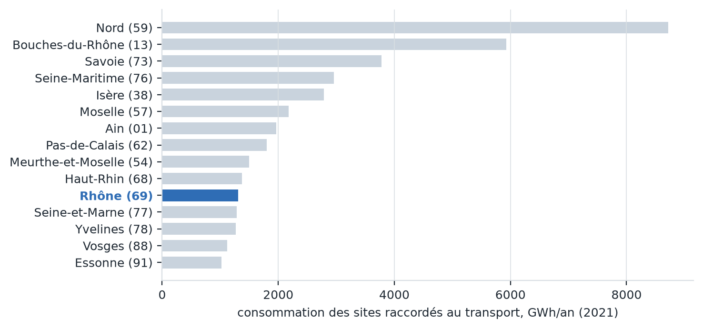
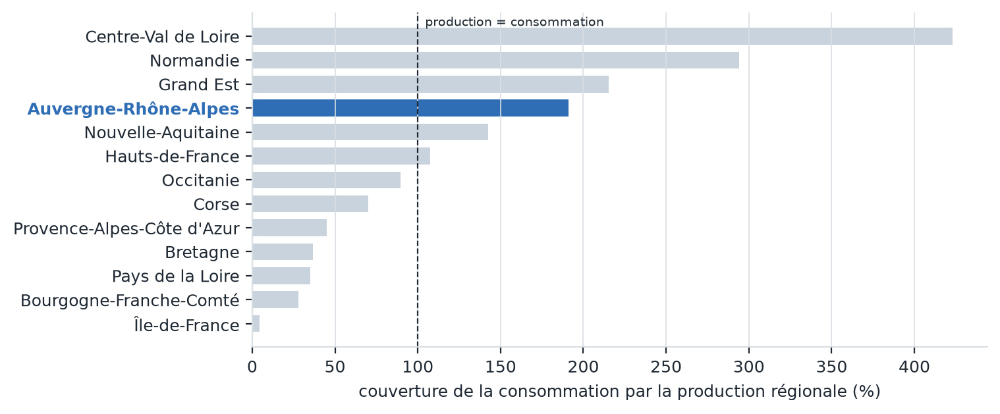
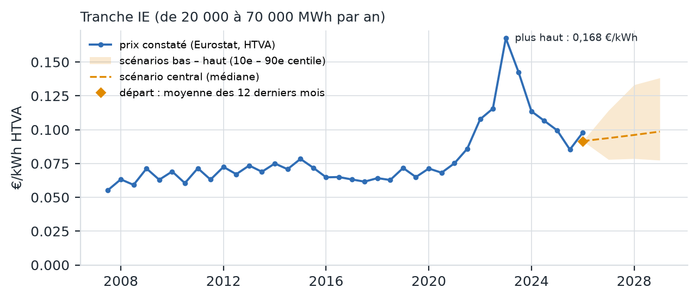
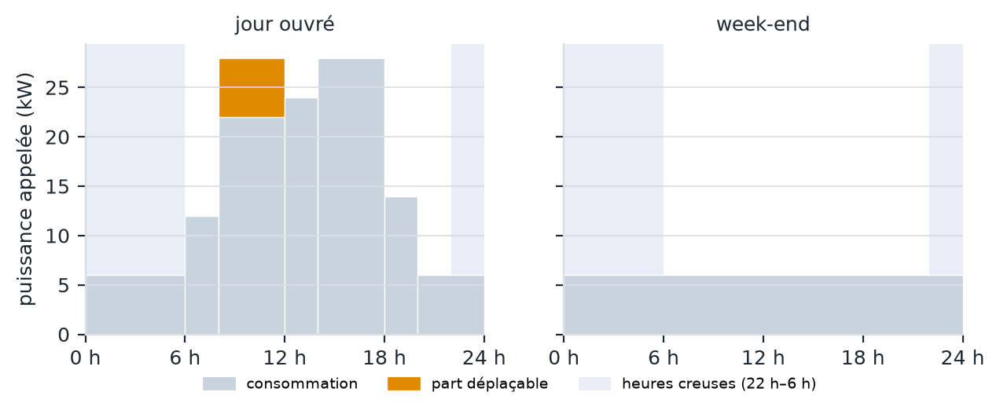

# Diagnostic d'implantation — 20 Rue de la République 69002 Lyon

*Commune Lyon (69123) · Rhône (69) · Auvergne-Rhône-Alpes (84)*  

Établi le 16/10/2026 à partir de données publiques ouvertes (RTE, ODRÉ, Eurostat, Géorisques). Chaque indicateur est suivi de sa limite méthodologique.

## L'essentiel : prix et carbone à cette adresse

- **Prix moyen : 0,0916 €/kWh HTVA, soit environ 5 500 000 € par an pour 60 000 MWh (tranche IE ; Eurostat, S2 2025 – S1 2026)**
- **Électricité décarbonée : oui (France continentale), 51,9 gCO₂e/kWh en cycle de vie, sous le seuil de 100 gCO₂e/kWh**
- **À savoir : Le prix ne dépend pas de l'adresse mais de la consommation (péréquation, Corse et outre-mer compris). Le carbone est la moyenne annuelle du réseau de ce territoire, pas celle d'un contrat de fourniture.**

## 1. Pression industrielle locale (sites raccordés au réseau de transport, 2021)

- Commune : 1 site(s), 49,6 GWh/an
- Département : 23 site(s) dans 19 commune(s), 1 309 GWh/an — rang 11 sur 90 départements

> **Limite.** Ne compte que les sites raccordés au réseau de transport (HTB) : les consommateurs raccordés à Enedis n'y figurent pas. Depuis 2022, environ 40 % des IRIS sont masqués par le secret statistique : le millésime retenu est donc le dernier publié en entier, au prix de quelques années d'ancienneté.

## 2. Tension du réseau régional (01/2025 – 12/2025, 12 mois)

- Production 119 231 GWh, consommation 62 405 GWh : couverture 191 % → région excédentaire
- Rang de dépendance : 10 sur 13 (1 = la plus déficitaire)

> **Limite.** Le réseau est interconnecté : une région déficitaire importe sans difficulté de ses voisines. Le solde décrit une dépendance structurelle, pas une pénurie ni un risque de coupure.

- Contraintes d'évacuation (RTE) : 14 575 MW d'EnR installés ou en projet, 187 MW à compenser, 2 777 MWh non évacués par an

> **Limite.** Contraintes d'évacuation de la production renouvelable (injection), données à titre indicatif par RTE. Elles ne mesurent pas la capacité disponible pour un consommateur (soutirage). Pas de donnée pour la Corse ni l'outre-mer.

- Contraintes prospectives (RTE, d'ici 3 à 5 ans) : aucune sur les ouvrages reliés aux postes du département.

> **Limite.** Contraintes de transit liées à l'accueil des énergies renouvelables (injection), que RTE prévoit de gérer par de la flexibilité plutôt que par de nouveaux ouvrages ; données indicatives et non engageantes. Elles ne mesurent pas la capacité disponible pour un consommateur. Ni les ouvrages ni les postes ne sont géolocalisés en open data : la maille est le département, pas l'adresse, et une liaison entre deux départements compte dans les deux.

## 3. Raccordement

- Puissance 12 MW → HTA, Enedis (ou ELD) : Raccordement en moyenne tension (20 kV), souvent sur un départ dédié au-delà de quelques MW

> **Limite.** Indicatif : 1 kVA est assimilé à 1 kW. Le domaine de tension réel est fixé par le gestionnaire lors de l'étude de raccordement.

- Postes RTE en exploitation dans le département : 91, dont 64 en HTB1 (63 à 150 kV), 19 en HTB2 (225 kV) et 3 en HTB3 (400 kV)

> **Limite.** Repère de densité du réseau de transport, pas une capacité de raccordement : un poste proche peut être saturé. Les postes ne sont pas géolocalisés en open data, et environ 3 % d'entre eux n'ont pas de département publié.

- Zone industrielle prioritaire de RTE la plus proche : Vallée de la chimie (P2), à 7 km (Saint-Fons) : capacité supplémentaire possible à partir de 2029, si les projets industriels de la zone se concrétisent ; ouvrages prévus : nouveau poste 225 kV « Rhôna » raccordé au poste 400 kV de Mions

> **Limite.** Zones et années cibles du schéma décennal de RTE, sous réserve des autorisations administratives et, pour les zones P2, de la concrétisation des projets industriels ; les zones P3 sont de simples exemples, sans date. Distance à vol d'oiseau jusqu'à la commune de référence de la zone, pas jusqu'au poste. Être proche d'une zone ne donne aucun droit d'accès au réseau : la capacité est attribuée selon les procédures de RTE. Concerne surtout les raccordements au réseau de transport (au-delà de quelques dizaines de MW).

- Site industriel clé en main (France 2030) le plus proche : Salaise-sur-Sanne, à 47 km ; annoncé prêt en 2026 - 2027

> **Limite.** Distance à vol d'oiseau jusqu'au point de la commune, pas jusqu'au site lui-même. La période de maturité est celle annoncée pour un site prêt à accueillir une activité ; elle ne garantit ni la disponibilité du foncier à la date voulue, ni la puissance électrique raccordable, à confirmer auprès de l'aménageur et du gestionnaire de réseau.

> **Limite.** La capacité de raccordement disponible pour la consommation n'est pas publiée en open data (Caparéseau ne couvre que l'injection). Seule une étude de raccordement RTE ou Enedis fait foi.

## 4. Prix de l'électricité pour l'entreprise (identique sur tout le territoire)

- Consommation 60 000 MWh/an → tranche IE (de 20 000 à 70 000 MWh par an), prix moyen constaté par Eurostat
- 12 derniers mois (S2 2025 – S1 2026) : 0,0916 €/kWh HTVA, dont 0,0079 €/kWh de taxes non récupérables → facture d'environ 5 500 000 € par an
- Repères depuis S2 2007 : moyenne sur 5 ans 0,1122 €/kWh, plus bas 0,0553 (S2 2007), plus haut 0,1676 (S1 2023)
- Prix moyen des 3 prochaines années, d'après l'historique de la tranche et les erreurs passées de la méthode : de 0,0762 à 0,1413 €/kWh, 0,0961 au centre → facture de 4 570 000 € à 8 480 000 € par an (5 760 000 € au centre)
- Contrôle sur le passé : appliquée à chaque semestre de S2 2019 à S1 2023, la méthode a encadré le prix moyen réel des 3 années suivantes 1 fois sur 8 (12 %, contre 80 % pour une méthode bien calibrée) ; il a dépassé le scénario haut 6 fois et est passé sous le scénario bas 1 fois. Ces périodes de 3 ans se chevauchent : ce ne sont pas des essais indépendants. Leurs écarts font désormais partie des erreurs qui calibrent la fourchette affichée.

> **Limite.** Prix moyen national constaté pour la tranche, hors TVA et taxes récupérables : identique en tout point du territoire (péréquation), il ne dépend pas de l'adresse. C'est une moyenne déclarée par les fournisseurs : un contrat donné peut s'en écarter nettement selon sa date de signature, sa durée et le profil du site. Les scénarios à 3 ans ne sont pas une prévision : le scénario central applique au prix des 12 derniers mois la variation médiane observée sur la tranche, et la fourchette reprend les erreurs passées de cette méthode (10e centile, médiane, 90e centile de l'écart entre prix réel et scénario central), crise de 2022-2023 comprise. Une rupture jamais observée la dépasserait encore.

## 5. Carbone du réseau et coût horaire d'un profil type

- Électricité du réseau décarbonée (France continentale) : 51,9 gCO₂e/kWh en cycle de vie (ADEME, année 2024), sous le seuil de 100 gCO₂e/kWh de la taxonomie européenne ; émissions directes observées par RTE sur 12 mois, jusqu'au 08/10/2026 : 19 gCO₂/kWh

> **Limite.** Intensité moyenne du réseau sur l'année, en cycle de vie (méthode location-based) : elle ne dit rien du contrat de fourniture ni des garanties d'origine achetées (méthode market-based), ni des heures de consommation, l'intensité variant fortement d'une heure à l'autre. Toutes les adresses du continent partagent la même valeur : le réseau y est interconnecté. Le seuil de 100 gCO2e/kWh est celui de la taxonomie européenne pour la production d'électricité ; « décarbonée » qualifie le réseau, pas l'entreprise, et ne permet pas à elle seule une allégation environnementale.

- Bureau tertiaire, 36 kVA, septembre 2026, option Heures Creuses du tarif bleu non résidentiel
- 9 600 kWh, dont 15 % en heures creuses : 1 586 € HTVA, soit 0,1652 €/kWh ; 22 gCO₂/kWh en moyenne
- Décaler 528 kWh flexibles vers les heures creuses : 22 € économisés, mais 1,4 kgCO₂ émis en plus : les heures creuses de nuit sont plus carbonées que la mi-journée solaire

> **Limite.** Le prix est identique en tout point du territoire (péréquation tarifaire) : ce coût ne dépend pas de l'adresse. Profil illustratif, heures creuses supposées de 22 h à 6 h (en réalité fixées localement par le gestionnaire de réseau), jours fériés comptés comme ouvrés, abonnement exclu. Carbone : intensité nationale, faute d'intensité régionale opposable.

## 6. Risques naturels et technologiques à l'adresse (Géorisques)

- Naturels, à l'adresse : Inondation, Remontée de nappe, Séisme (faible), Retrait-gonflement des argiles (modéré), Radon (faible)
- Technologiques, à l'adresse : Pollution des sols
- Présents dans la commune, non évalués à l'adresse : Rupture de barrage
- Présents dans la commune, mais l'adresse n'est pas concernée : Installations industrielles classées (ICPE), Canalisations de matières dangereuses
- Rapport officiel : https://www.georisques.gouv.fr/mes-risques/connaitre-les-risques-pres-de-chez-moi/rapport2?typeForm=adresse&city=Lyon&codeInsee=69123&lon=4.835685&lat=45.763721&adresse=20+Rue+de+la+R%C3%A9publique%2C+69002+Lyon

> **Limite.** Croisement de la position géocodée avec les zonages réglementaires et les cartographies d'aléas disponibles : le résultat dépend de la précision du géocodage et de la couverture des cartes, et un risque « non évalué » à l'adresse n'est pas un risque absent. Ce n'est ni l'état des risques réglementaire, obligatoire pour une vente ou une location, ni une étude de sol ou de vulnérabilité du site.

## Sources

- Géocodage : Base Adresse Nationale, via la Géoplateforme de l'IGN (data.geopf.fr).
- Pression industrielle : ODRÉ, consommation-annuelle-par-iris (RTE, GRTgaz, Teréga).
- Tension régionale : ODRÉ, equilibre-regional-mensuel-prod-conso-brute et contraintes-regionales (RTE).
- Prix de l'électricité des entreprises : Eurostat, nrg_pc_205 (semestriel, par tranche).
- Risques à l'adresse : Géorisques (ministère de la Transition écologique, BRGM), rapport de risques ; à défaut, base GASPAR et zonage sismique de la commune.
- Profil type : barèmes du tarif bleu non résidentiel, délibérations de la CRE n° 2026-06 et n° 2026-147. Carbone : éCO2mix national (RTE).
